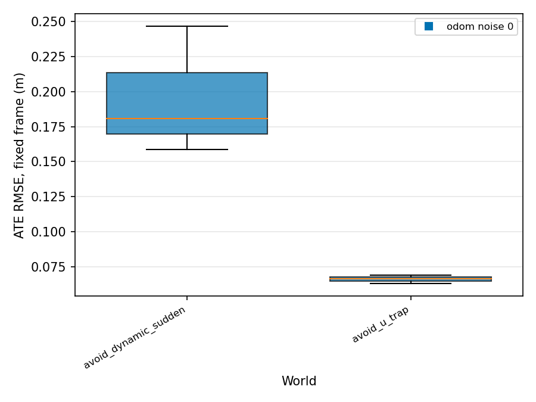
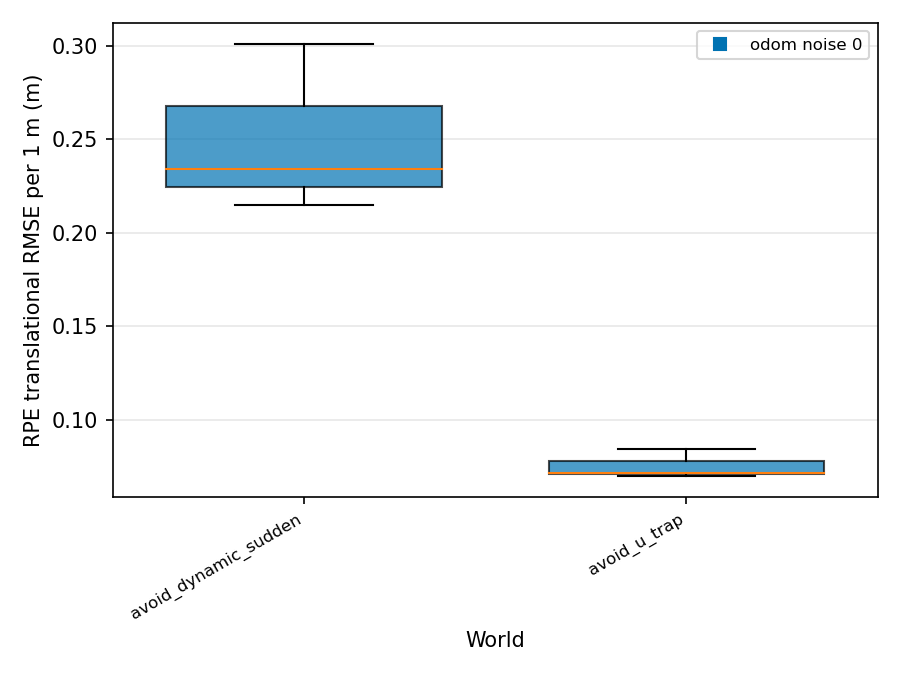
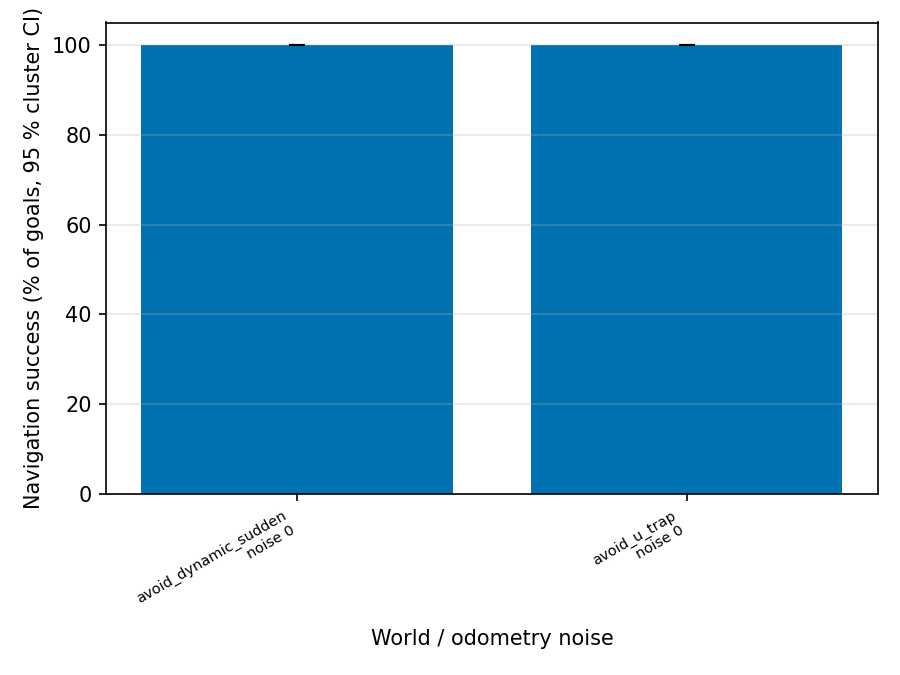
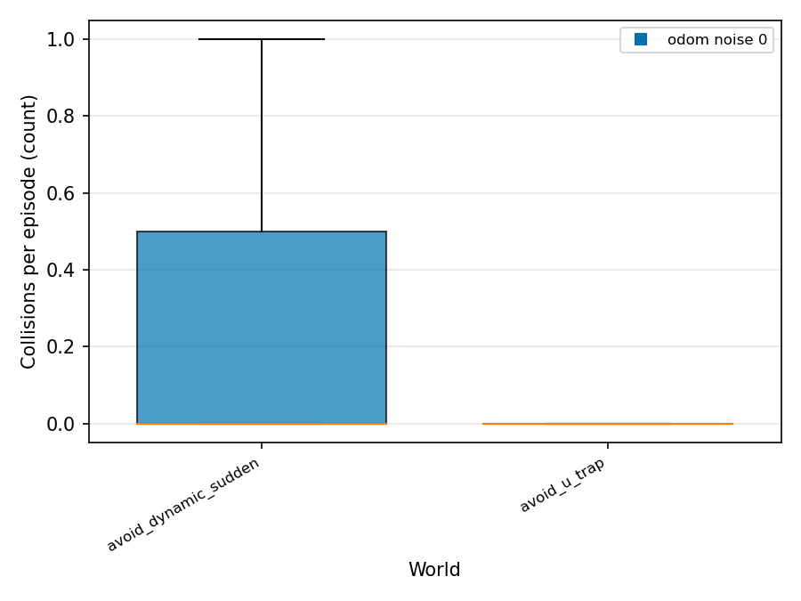

# Final results

Roots: `/home/hrishikesh/eval_runs/quick_avoidance`

Unit of analysis is the episode (pre-registration 13.5). Statistics use status ok/partial episodes only. Mean ± sd, bootstrap CI (per world) or cluster bootstrap CI (pooled: worlds, then seeds). Rows with n < 3 are marked INSUFFICIENT DATA.

## Core metrics

### Coverage (explored) (`coverage_explored_pct`, %)

INSUFFICIENT DATA: metric not present in any aggregate.

### Coverage (cleaned, secondary) (`coverage_cleaned_pct`, %)

| experiment | world | noise | method | n | mean ± sd | 95 % boot CI | n_invalid | n_failed | note |
|---|---|---|---|---|---|---|---|---|---|
| quick_avoidance | avoid_dynamic_sudden | 0 | scripted_goals | 3 | 6.9 ± 1.2 | [5.8, 8.2] | 0 | 0 |  |
| quick_avoidance | avoid_u_trap | 0 | scripted_goals | 3 | 5.5 ± 0.1 | [5.5, 5.6] | 0 | 0 |  |
| quick_avoidance | **pooled** (2 worlds) | 0 | scripted_goals | 6 | 6.2 ± 1.1 | [5.5, 7.4] cluster | | |  |

### Steps: goals (`n_goals`, count)

| experiment | world | noise | method | n | mean ± sd | 95 % boot CI | n_invalid | n_failed | note |
|---|---|---|---|---|---|---|---|---|---|
| quick_avoidance | avoid_dynamic_sudden | 0 | scripted_goals | 3 | 0.0 ± 0.0 | [0.0, 0.0] | 0 | 0 |  |
| quick_avoidance | avoid_u_trap | 0 | scripted_goals | 3 | 0.0 ± 0.0 | [0.0, 0.0] | 0 | 0 |  |
| quick_avoidance | **pooled** (2 worlds) | 0 | scripted_goals | 6 | 0.0 ± 0.0 | [0.0, 0.0] cluster | | |  |

### Steps: command ticks (`n_cmd_ticks`, count)

| experiment | world | noise | method | n | mean ± sd | 95 % boot CI | n_invalid | n_failed | note |
|---|---|---|---|---|---|---|---|---|---|
| quick_avoidance | avoid_dynamic_sudden | 0 | scripted_goals | 3 | 1149.7 ± 506.7 | [748.0, 1719.0] | 0 | 0 |  |
| quick_avoidance | avoid_u_trap | 0 | scripted_goals | 3 | 390.3 ± 19.4 | [368.0, 403.0] | 0 | 0 |  |
| quick_avoidance | **pooled** (2 worlds) | 0 | scripted_goals | 6 | 770.0 ± 525.2 | [379.7, 1350.5] cluster | | |  |

### Steps: recoveries (`n_recoveries`, count)

| experiment | world | noise | method | n | mean ± sd | 95 % boot CI | n_invalid | n_failed | note |
|---|---|---|---|---|---|---|---|---|---|
| quick_avoidance | avoid_dynamic_sudden | 0 | scripted_goals | 3 | 4.3 ± 2.3 | [3.0, 7.0] | 0 | 0 |  |
| quick_avoidance | avoid_u_trap | 0 | scripted_goals | 3 | 0.0 ± 0.0 | [0.0, 0.0] | 0 | 0 |  |
| quick_avoidance | **pooled** (2 worlds) | 0 | scripted_goals | 6 | 2.2 ± 2.8 | [0.0, 5.0] cluster | | |  |

### Total collisions (`n_collisions`, count)

| experiment | world | noise | method | n | mean ± sd | 95 % boot CI | n_invalid | n_failed | note |
|---|---|---|---|---|---|---|---|---|---|
| quick_avoidance | avoid_dynamic_sudden | 0 | scripted_goals | 3 | 0.3 ± 0.6 | [0.0, 1.0] | 0 | 0 |  |
| quick_avoidance | avoid_u_trap | 0 | scripted_goals | 3 | 0.0 ± 0.0 | [0.0, 0.0] | 0 | 0 |  |
| quick_avoidance | **pooled** (2 worlds) | 0 | scripted_goals | 6 | 0.2 ± 0.4 | [0.0, 0.5] cluster | | |  |

### Obstacle avoidance (`avoidance_pct`, %)

| experiment | world | noise | method | n | mean ± sd | 95 % boot CI | n_invalid | n_failed | note |
|---|---|---|---|---|---|---|---|---|---|
| quick_avoidance | avoid_dynamic_sudden | 0 | scripted_goals | 2 | 50.0 ± 70.7 | [0.0, 100.0] | 0 | 0 | INSUFFICIENT DATA (n<3) |
| quick_avoidance | avoid_u_trap | 0 | scripted_goals | 3 | 100.0 ± 0.0 | [100.0, 100.0] | 0 | 0 |  |
| quick_avoidance | **pooled** (2 worlds) | 0 | scripted_goals | 5 | 80.0 ± 44.7 | [25.0, 100.0] cluster | | |  |

### Responsiveness (`responsiveness_pct`, %)

| experiment | world | noise | method | n | mean ± sd | 95 % boot CI | n_invalid | n_failed | note |
|---|---|---|---|---|---|---|---|---|---|
| quick_avoidance | avoid_dynamic_sudden | 0 | scripted_goals | 3 | 33.3 ± 57.7 | [0.0, 100.0] | 0 | 0 |  |
| quick_avoidance | avoid_u_trap | 0 | scripted_goals | 0 | - | - | 0 | 0 | NO DATA |
| quick_avoidance | **pooled** (1 worlds) | 0 | scripted_goals | 3 | 33.3 ± 57.7 | [0.0, 100.0] cluster | | |  |

Pooled rate (`resp_n_met`):

| experiment | world | noise | method | events | episodes | pooled % | 95 % cluster CI | naive Wilson (ignores clustering) | n_invalid | n_failed |
|---|---|---|---|---|---|---|---|---|---|---|
| quick_avoidance | avoid_dynamic_sudden | 0 | scripted_goals | 3 | 3 | 33.3 | [0.0, 100.0] | [6.1, 79.2] | 0 | 0 |

### ATE (fixed frame) (`ate_fixed_rmse_m`, m)

| experiment | world | noise | method | n | mean ± sd | 95 % boot CI | n_invalid | n_failed | note |
|---|---|---|---|---|---|---|---|---|---|
| quick_avoidance | avoid_dynamic_sudden | 0 | scripted_goals | 3 | 0.195 ± 0.046 | [0.159, 0.246] | 0 | 0 |  |
| quick_avoidance | avoid_u_trap | 0 | scripted_goals | 3 | 0.066 ± 0.003 | [0.063, 0.069] | 0 | 0 |  |
| quick_avoidance | **pooled** (2 worlds) | 0 | scripted_goals | 6 | 0.131 ± 0.076 | [0.065, 0.214] cluster | | |  |

### RPE (1 m) (`rpe_trans_rmse_m_1m`, m)

| experiment | world | noise | method | n | mean ± sd | 95 % boot CI | n_invalid | n_failed | note |
|---|---|---|---|---|---|---|---|---|---|
| quick_avoidance | avoid_dynamic_sudden | 0 | scripted_goals | 3 | 0.250 ± 0.045 | [0.215, 0.301] | 0 | 0 |  |
| quick_avoidance | avoid_u_trap | 0 | scripted_goals | 3 | 0.075 ± 0.008 | [0.070, 0.084] | 0 | 0 |  |
| quick_avoidance | **pooled** (2 worlds) | 0 | scripted_goals | 6 | 0.163 ± 0.100 | [0.072, 0.267] cluster | | |  |

### Map completeness (`map_completeness_pct`, %)

INSUFFICIENT DATA: metric not present in any aggregate.

### Avoidance trial success (`avoid_trial_success_pct`, %)

INSUFFICIENT DATA: metric not present in any aggregate.

### Navigation success (GT) (`nav_success_gt_pct`, %)

| experiment | world | noise | method | n | mean ± sd | 95 % boot CI | n_invalid | n_failed | note |
|---|---|---|---|---|---|---|---|---|---|
| quick_avoidance | avoid_dynamic_sudden | 0 | scripted_goals | 3 | 66.7 ± 57.7 | [0.0, 100.0] | 0 | 0 |  |
| quick_avoidance | avoid_u_trap | 0 | scripted_goals | 3 | 100.0 ± 0.0 | [100.0, 100.0] | 0 | 0 |  |
| quick_avoidance | **pooled** (2 worlds) | 0 | scripted_goals | 6 | 83.3 ± 40.8 | [33.3, 100.0] cluster | | |  |

Pooled rate (`nav_goals_succeeded`):

| experiment | world | noise | method | events | episodes | pooled % | 95 % cluster CI | naive Wilson (ignores clustering) | n_invalid | n_failed |
|---|---|---|---|---|---|---|---|---|---|---|
| quick_avoidance | avoid_dynamic_sudden | 0 | scripted_goals | 3 | 3 | 100.0 | [100.0, 100.0] | [43.8, 100.0] | 0 | 0 |
| quick_avoidance | avoid_u_trap | 0 | scripted_goals | 3 | 3 | 100.0 | [100.0, 100.0] | [43.8, 100.0] | 0 | 0 |

### Loop closure precision (`lc_precision_pct`, %)

INSUFFICIENT DATA: metric not present in any aggregate.

### Loop closure recall (`lc_recall_pct`, %)

INSUFFICIENT DATA: metric not present in any aggregate.

### Path length ratio (`path_length_ratio_mean`, -)

| experiment | world | noise | method | n | mean ± sd | 95 % boot CI | n_invalid | n_failed | note |
|---|---|---|---|---|---|---|---|---|---|
| quick_avoidance | avoid_dynamic_sudden | 0 | scripted_goals | 3 | 2.023 ± 0.442 | [1.582, 2.465] | 0 | 0 |  |
| quick_avoidance | avoid_u_trap | 0 | scripted_goals | 3 | 1.076 ± 0.010 | [1.069, 1.088] | 0 | 0 |  |
| quick_avoidance | **pooled** (2 worlds) | 0 | scripted_goals | 6 | 1.549 ± 0.589 | [1.072, 2.171] cluster | | |  |

### Cleaning efficiency (secondary) (`cleaning_efficiency`, -)

| experiment | world | noise | method | n | mean ± sd | 95 % boot CI | n_invalid | n_failed | note |
|---|---|---|---|---|---|---|---|---|---|
| quick_avoidance | avoid_dynamic_sudden | 0 | scripted_goals | 3 | 0.059 ± 0.009 | [0.051, 0.069] | 0 | 0 |  |
| quick_avoidance | avoid_u_trap | 0 | scripted_goals | 3 | 0.055 ± 0.001 | [0.055, 0.056] | 0 | 0 |  |
| quick_avoidance | **pooled** (2 worlds) | 0 | scripted_goals | 6 | 0.057 ± 0.006 | [0.053, 0.063] cluster | | |  |

## Additional metrics (A1-A15)

### A1 Time to 50 % explored (`t_to_50_explored_s`, s)

INSUFFICIENT DATA: metric not present in any aggregate.

### A1 Explored AUC (`coverage_explored_auc`, %)

INSUFFICIENT DATA: metric not present in any aggregate.

### A2 Overlap ratio (`overlap_ratio`, -)

| experiment | world | noise | method | n | mean ± sd | 95 % boot CI | n_invalid | n_failed | note |
|---|---|---|---|---|---|---|---|---|---|
| quick_avoidance | avoid_dynamic_sudden | 0 | scripted_goals | 3 | 1.170 ± 0.040 | [1.126, 1.205] | 0 | 0 |  |
| quick_avoidance | avoid_u_trap | 0 | scripted_goals | 3 | 1.000 ± 0.000 | [1.000, 1.000] | 0 | 0 |  |
| quick_avoidance | **pooled** (2 worlds) | 0 | scripted_goals | 6 | 1.085 ± 0.097 | [1.000, 1.188] cluster | | |  |

### A3 Missed area (`missed_area_m2`, m2)

| experiment | world | noise | method | n | mean ± sd | 95 % boot CI | n_invalid | n_failed | note |
|---|---|---|---|---|---|---|---|---|---|
| quick_avoidance | avoid_dynamic_sudden | 0 | scripted_goals | 3 | 22.079 ± 0.285 | [21.778, 22.345] | 0 | 0 |  |
| quick_avoidance | avoid_u_trap | 0 | scripted_goals | 3 | 22.268 ± 0.015 | [22.258, 22.285] | 0 | 0 |  |
| quick_avoidance | **pooled** (2 worlds) | 0 | scripted_goals | 6 | 22.173 ± 0.208 | [21.967, 22.281] cluster | | |  |

### A4 Distance (GT) (`distance_gt_m`, m)

| experiment | world | noise | method | n | mean ± sd | 95 % boot CI | n_invalid | n_failed | note |
|---|---|---|---|---|---|---|---|---|---|
| quick_avoidance | avoid_dynamic_sudden | 0 | scripted_goals | 3 | 8.065 ± 1.697 | [6.429, 9.816] | 0 | 0 |  |
| quick_avoidance | avoid_u_trap | 0 | scripted_goals | 3 | 5.250 ± 0.072 | [5.168, 5.304] | 0 | 0 |  |
| quick_avoidance | **pooled** (2 worlds) | 0 | scripted_goals | 6 | 6.657 ± 1.879 | [5.213, 8.687] cluster | | |  |

### A4 Energy proxy (`energy_proxy_m2ps`, m2/s)

| experiment | world | noise | method | n | mean ± sd | 95 % boot CI | n_invalid | n_failed | note |
|---|---|---|---|---|---|---|---|---|---|
| quick_avoidance | avoid_dynamic_sudden | 0 | scripted_goals | 3 | 4.246 ± 0.733 | [3.461, 4.914] | 0 | 0 |  |
| quick_avoidance | avoid_u_trap | 0 | scripted_goals | 3 | 2.965 ± 0.042 | [2.920, 3.004] | 0 | 0 |  |
| quick_avoidance | **pooled** (2 worlds) | 0 | scripted_goals | 6 | 3.606 ± 0.841 | [2.943, 4.546] cluster | | |  |

### A5 Min clearance (`min_clearance_m`, m)

| experiment | world | noise | method | n | mean ± sd | 95 % boot CI | n_invalid | n_failed | note |
|---|---|---|---|---|---|---|---|---|---|
| quick_avoidance | avoid_dynamic_sudden | 0 | scripted_goals | 3 | 0.165 ± 0.149 | [0.000, 0.290] | 0 | 0 |  |
| quick_avoidance | avoid_u_trap | 0 | scripted_goals | 3 | 0.152 ± 0.004 | [0.149, 0.156] | 0 | 0 |  |
| quick_avoidance | **pooled** (2 worlds) | 0 | scripted_goals | 6 | 0.159 ± 0.095 | [0.076, 0.227] cluster | | |  |

### A8 Planning latency (`plan_latency_ms_mean`, ms)

| experiment | world | noise | method | n | mean ± sd | 95 % boot CI | n_invalid | n_failed | note |
|---|---|---|---|---|---|---|---|---|---|
| quick_avoidance | avoid_dynamic_sudden | 0 | scripted_goals | 3 | 5.3 ± 6.1 | [0.0, 12.0] | 0 | 0 |  |
| quick_avoidance | avoid_u_trap | 0 | scripted_goals | 3 | 1.3 ± 2.3 | [0.0, 4.0] | 0 | 0 |  |
| quick_avoidance | **pooled** (2 worlds) | 0 | scripted_goals | 6 | 3.3 ± 4.7 | [0.0, 8.7] cluster | | |  |

### A9 Path smoothness (`smooth_curvature_rms_1pm`, 1/m)

| experiment | world | noise | method | n | mean ± sd | 95 % boot CI | n_invalid | n_failed | note |
|---|---|---|---|---|---|---|---|---|---|
| quick_avoidance | avoid_dynamic_sudden | 0 | scripted_goals | 3 | 5.926 ± 0.873 | [4.973, 6.686] | 0 | 0 |  |
| quick_avoidance | avoid_u_trap | 0 | scripted_goals | 3 | 1.357 ± 0.237 | [1.133, 1.606] | 0 | 0 |  |
| quick_avoidance | **pooled** (2 worlds) | 0 | scripted_goals | 6 | 3.642 ± 2.568 | [1.245, 6.309] cluster | | |  |

### A10 Odometry drift ratio (`odom_drift_ratio`, -)

| experiment | world | noise | method | n | mean ± sd | 95 % boot CI | n_invalid | n_failed | note |
|---|---|---|---|---|---|---|---|---|---|
| quick_avoidance | avoid_dynamic_sudden | 0 | scripted_goals | 3 | 0.030 ± 0.041 | [0.003, 0.078] | 0 | 0 |  |
| quick_avoidance | avoid_u_trap | 0 | scripted_goals | 3 | 0.009 ± 0.002 | [0.007, 0.012] | 0 | 0 |  |
| quick_avoidance | **pooled** (2 worlds) | 0 | scripted_goals | 6 | 0.020 ± 0.029 | [0.006, 0.044] cluster | | |  |

### A12 True RTF (`rtf_true_mean`, -)

| experiment | world | noise | method | n | mean ± sd | 95 % boot CI | n_invalid | n_failed | note |
|---|---|---|---|---|---|---|---|---|---|
| quick_avoidance | avoid_dynamic_sudden | 0 | scripted_goals | 3 | 0.823 ± 0.026 | [0.804, 0.852] | 0 | 0 |  |
| quick_avoidance | avoid_u_trap | 0 | scripted_goals | 3 | 0.999 ± 0.001 | [0.997, 1.000] | 0 | 0 |  |
| quick_avoidance | **pooled** (2 worlds) | 0 | scripted_goals | 6 | 0.911 ± 0.098 | [0.812, 1.000] cluster | | |  |

### A14 AMCL localization error (`loc_error_mean_m`, m)

| experiment | world | noise | method | n | mean ± sd | 95 % boot CI | n_invalid | n_failed | note |
|---|---|---|---|---|---|---|---|---|---|
| quick_avoidance | avoid_dynamic_sudden | 0 | scripted_goals | 3 | 0.165 ± 0.026 | [0.138, 0.190] | 0 | 0 |  |
| quick_avoidance | avoid_u_trap | 0 | scripted_goals | 3 | 0.060 ± 0.001 | [0.059, 0.061] | 0 | 0 |  |
| quick_avoidance | **pooled** (2 worlds) | 0 | scripted_goals | 6 | 0.112 ± 0.060 | [0.059, 0.174] cluster | | |  |

## Method comparisons (Holm-adjusted across the family)

No method comparisons in the data (method comparison is on hold).

## Figures

Metrics with no data: `coverage_explored_pct`, `map_completeness_pct`, `avoid_trial_success_pct`, `lc_precision_pct`, `lc_recall_pct`, `t_to_50_explored_s`, `coverage_explored_auc`

## Metric health

Per-episode classification (precedence UNMEASURABLE > SUSPECT > LOW_N > BAD > OK). BAD floors are pre-registered diagnosis triggers, not exclusions.

| metric | OK | LOW_N | UNMEASURABLE | SUSPECT | BAD | NA | top reasons | fallback to report |
|---|---|---|---|---|---|---|---|---|
| `coverage_explored_pct` | 0 | 0 | 6 | 0 | 0 | 0 | NO_DATA x6 | - |
| `n_goals` | 6 | 0 | 0 | 0 | 0 | 0 | - | - |
| `n_collisions` | 6 | 0 | 0 | 0 | 0 | 0 | - | - |
| `avoidance_pct` | 0 | 5 | 1 | 0 | 0 | 0 | LOW_N x5, BELOW_FLOOR x1, NO_EVENTS x1 | - |
| `responsiveness_pct` | 0 | 3 | 3 | 0 | 0 | 0 | LOW_N x3, NO_EVENTS x3 | - |
| `ate_fixed_rmse_m` | 5 | 0 | 0 | 1 | 0 | 0 | ODOM_CORRUPTED x1 | `ate_fixed_rmse_m_pre_corrupt` |
| `rpe_trans_rmse_m_1m` | 5 | 0 | 0 | 1 | 0 | 0 | ODOM_CORRUPTED x1 | `rpe_trans_rmse_m_5s` |
| `map_completeness_pct` | 0 | 0 | 6 | 0 | 0 | 0 | MAP_MISSING x6 | - |
| `trial_success` | 6 | 0 | 0 | 0 | 0 | 0 | - | - |
| `nav_success_gt_pct` | 0 | 5 | 0 | 1 | 0 | 0 | LOW_N x6, NAV_GT_DIVERGENCE x1, BELOW_FLOOR x1 | `nav_success_pct (Nav2-reported)` |
| `lc_precision_pct` | 0 | 0 | 6 | 0 | 0 | 0 | NO_EVENTS x6 | - |
| `lc_recall_pct` | 0 | 0 | 6 | 0 | 0 | 0 | NO_EVENTS x6 | - |
| `path_length_ratio_mean` | 0 | 6 | 0 | 0 | 0 | 0 | LOW_N x6 | - |
| `cleaning_efficiency` | 6 | 0 | 0 | 0 | 0 | 0 | - | - |

## Reported regardless of outcome (pre-registration 13.5b)

| experiment | world | noise | ok | partial | invalid | failed | total |
|---|---|---|---|---|---|---|---|
| quick_avoidance | avoid_dynamic_sudden | 0 | 3 | 0 | 0 | 0 | 3 |
| quick_avoidance | avoid_u_trap | 0 | 3 | 0 | 0 | 0 | 3 |

Totals: ok=6

### Deviations from the pre-registration

None recorded (no deviations.md in the given roots). Check batch_manifest.json git commit against the frozen document.

Unfavourable results and negative loop-closure results are shown in the tables above without filtering.

