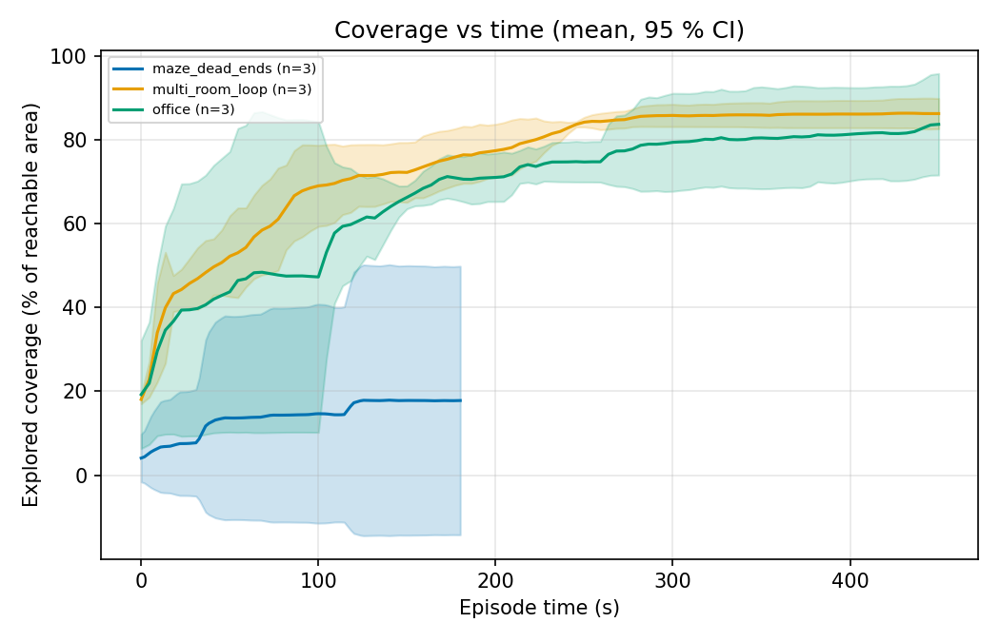
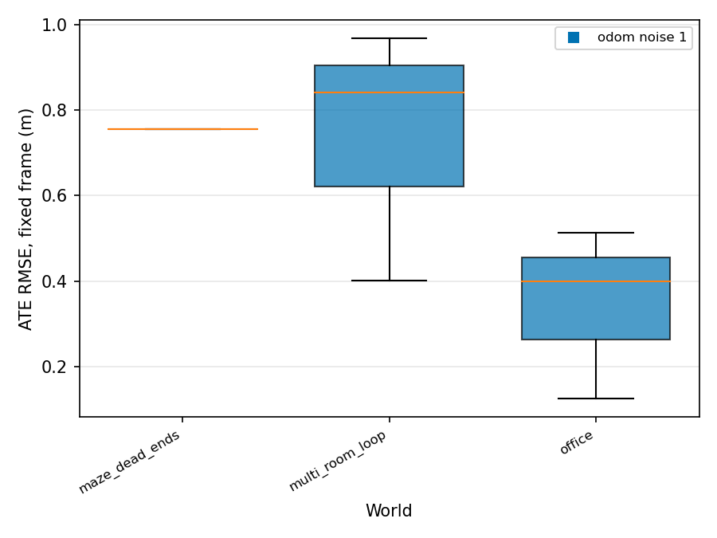
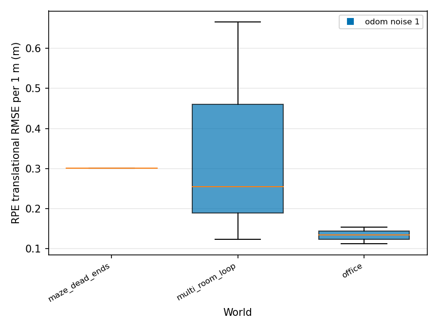
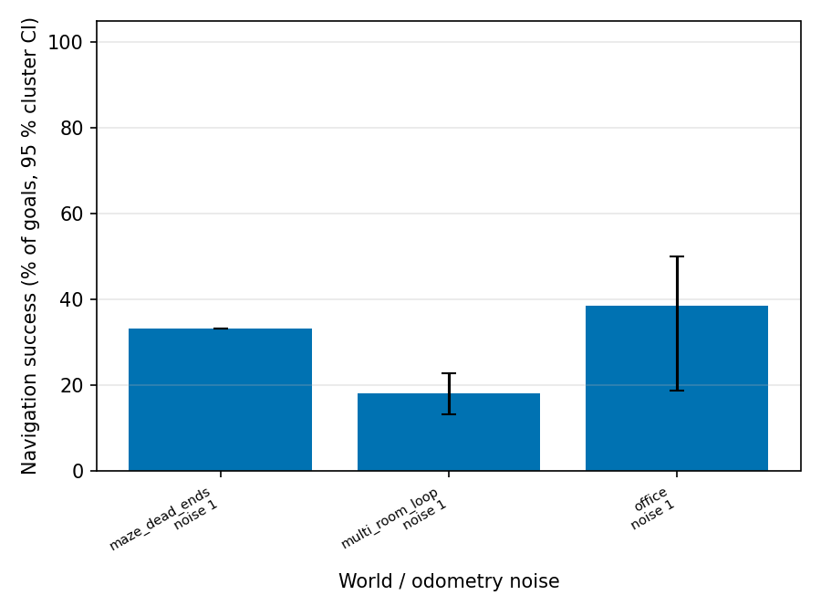
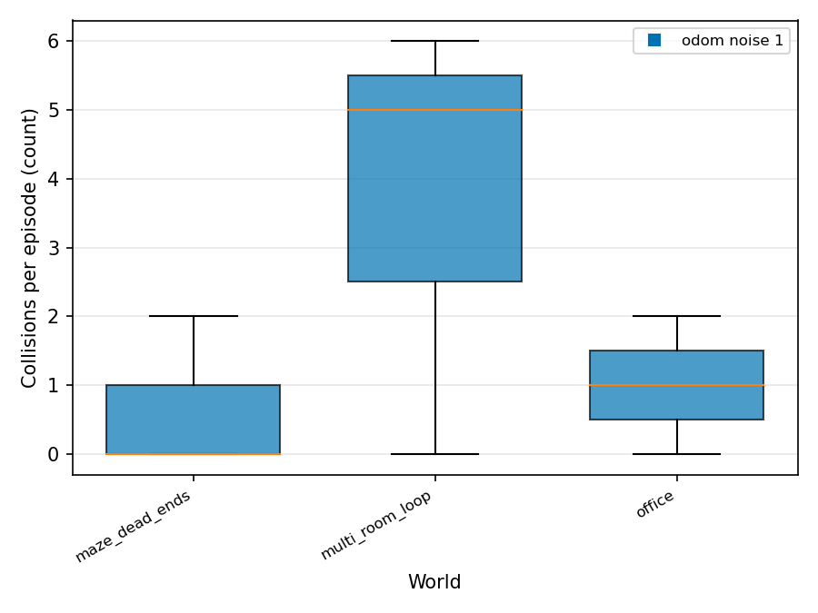

# Final results

Roots: `/home/hrishikesh/eval_runs/quick_exploration_noise`

Unit of analysis is the episode (pre-registration 13.5). Statistics use status ok/partial episodes only. Mean ± sd, bootstrap CI (per world) or cluster bootstrap CI (pooled: worlds, then seeds). Rows with n < 3 are marked INSUFFICIENT DATA.

## Core metrics

### Coverage (explored) (`coverage_explored_pct`, %)

| experiment | world | noise | method | n | mean ± sd | 95 % boot CI | n_invalid | n_failed | note |
|---|---|---|---|---|---|---|---|---|---|
| quick_exploration_noise | maze_dead_ends | 1 | frontier | 3 | 14.3 ± 22.2 | [1.2, 39.9] | 0 | 0 |  |
| quick_exploration_noise | multi_room_loop | 1 | frontier | 3 | 86.3 ± 3.2 | [82.6, 88.6] | 0 | 0 |  |
| quick_exploration_noise | office | 1 | frontier | 3 | 83.8 ± 10.8 | [71.5, 91.6] | 0 | 0 |  |
| quick_exploration_noise | **pooled** (3 worlds) | 1 | frontier | 9 | 61.4 ± 37.5 | [18.5, 88.0] cluster | | |  |

### Coverage (cleaned, secondary) (`coverage_cleaned_pct`, %)

| experiment | world | noise | method | n | mean ± sd | 95 % boot CI | n_invalid | n_failed | note |
|---|---|---|---|---|---|---|---|---|---|
| quick_exploration_noise | maze_dead_ends | 1 | frontier | 3 | 5.7 ± 9.9 | [0.0, 17.2] | 0 | 0 |  |
| quick_exploration_noise | multi_room_loop | 1 | frontier | 3 | 14.2 ± 2.7 | [11.1, 16.1] | 0 | 0 |  |
| quick_exploration_noise | office | 1 | frontier | 3 | 14.0 ± 5.8 | [10.6, 20.7] | 0 | 0 |  |
| quick_exploration_noise | **pooled** (3 worlds) | 1 | frontier | 9 | 11.3 ± 7.2 | [5.3, 16.2] cluster | | |  |

### Steps: goals (`n_goals`, count)

| experiment | world | noise | method | n | mean ± sd | 95 % boot CI | n_invalid | n_failed | note |
|---|---|---|---|---|---|---|---|---|---|
| quick_exploration_noise | maze_dead_ends | 1 | frontier | 3 | 6.3 ± 11.0 | [0.0, 19.0] | 0 | 0 |  |
| quick_exploration_noise | multi_room_loop | 1 | frontier | 3 | 19.3 ± 3.5 | [16.0, 23.0] | 0 | 0 |  |
| quick_exploration_noise | office | 1 | frontier | 3 | 20.0 ± 3.0 | [17.0, 23.0] | 0 | 0 |  |
| quick_exploration_noise | **pooled** (3 worlds) | 1 | frontier | 9 | 15.2 ± 8.9 | [6.3, 21.0] cluster | | |  |

### Steps: command ticks (`n_cmd_ticks`, count)

| experiment | world | noise | method | n | mean ± sd | 95 % boot CI | n_invalid | n_failed | note |
|---|---|---|---|---|---|---|---|---|---|
| quick_exploration_noise | maze_dead_ends | 1 | frontier | 3 | 2737.3 ± 4671.1 | [40.0, 8131.0] | 0 | 0 |  |
| quick_exploration_noise | multi_room_loop | 1 | frontier | 3 | 9497.3 ± 1887.8 | [7347.0, 10882.0] | 0 | 0 |  |
| quick_exploration_noise | office | 1 | frontier | 3 | 10213.0 ± 1162.3 | [8885.0, 11045.0] | 0 | 0 |  |
| quick_exploration_noise | **pooled** (3 worlds) | 1 | frontier | 9 | 7482.6 ± 4409.7 | [3192.7, 10460.4] cluster | | |  |

### Steps: recoveries (`n_recoveries`, count)

| experiment | world | noise | method | n | mean ± sd | 95 % boot CI | n_invalid | n_failed | note |
|---|---|---|---|---|---|---|---|---|---|
| quick_exploration_noise | maze_dead_ends | 1 | frontier | 3 | 30.0 ± 52.0 | [0.0, 90.0] | 0 | 0 |  |
| quick_exploration_noise | multi_room_loop | 1 | frontier | 3 | 104.3 ± 11.4 | [95.0, 117.0] | 0 | 0 |  |
| quick_exploration_noise | office | 1 | frontier | 3 | 111.3 ± 27.5 | [83.0, 138.0] | 0 | 0 |  |
| quick_exploration_noise | **pooled** (3 worlds) | 1 | frontier | 9 | 81.9 ± 49.2 | [31.0, 116.0] cluster | | |  |

### Total collisions (`n_collisions`, count)

| experiment | world | noise | method | n | mean ± sd | 95 % boot CI | n_invalid | n_failed | note |
|---|---|---|---|---|---|---|---|---|---|
| quick_exploration_noise | maze_dead_ends | 1 | frontier | 3 | 0.7 ± 1.2 | [0.0, 2.0] | 0 | 0 |  |
| quick_exploration_noise | multi_room_loop | 1 | frontier | 3 | 3.7 ± 3.2 | [0.0, 6.0] | 0 | 0 |  |
| quick_exploration_noise | office | 1 | frontier | 3 | 1.0 ± 1.0 | [0.0, 2.0] | 0 | 0 |  |
| quick_exploration_noise | **pooled** (3 worlds) | 1 | frontier | 9 | 1.8 ± 2.3 | [0.4, 3.9] cluster | | |  |

### Obstacle avoidance (`avoidance_pct`, %)

| experiment | world | noise | method | n | mean ± sd | 95 % boot CI | n_invalid | n_failed | note |
|---|---|---|---|---|---|---|---|---|---|
| quick_exploration_noise | maze_dead_ends | 1 | frontier | 0 | - | - | 0 | 0 | NO DATA |
| quick_exploration_noise | multi_room_loop | 1 | frontier | 3 | 98.7 ± 2.3 | [96.0, 100.0] | 0 | 0 |  |
| quick_exploration_noise | office | 1 | frontier | 3 | 98.1 ± 1.8 | [96.6, 100.0] | 0 | 0 |  |
| quick_exploration_noise | **pooled** (2 worlds) | 1 | frontier | 6 | 98.4 ± 1.9 | [96.9, 100.0] cluster | | |  |

### Responsiveness (`responsiveness_pct`, %)

| experiment | world | noise | method | n | mean ± sd | 95 % boot CI | n_invalid | n_failed | note |
|---|---|---|---|---|---|---|---|---|---|
| quick_exploration_noise | maze_dead_ends | 1 | frontier | 1 | 78.9 ± - | [-, -] | 0 | 0 | INSUFFICIENT DATA (n<3) |
| quick_exploration_noise | multi_room_loop | 1 | frontier | 3 | 71.3 ± 11.9 | [60.9, 84.2] | 0 | 0 |  |
| quick_exploration_noise | office | 1 | frontier | 3 | 76.1 ± 6.1 | [70.6, 82.6] | 0 | 0 |  |
| quick_exploration_noise | **pooled** (3 worlds) | 1 | frontier | 7 | 74.4 ± 8.3 | [67.9, 80.0] cluster | | |  |

Pooled rate (`resp_n_met`):

| experiment | world | noise | method | events | episodes | pooled % | 95 % cluster CI | naive Wilson (ignores clustering) | n_invalid | n_failed |
|---|---|---|---|---|---|---|---|---|---|---|
| quick_exploration_noise | maze_dead_ends | 1 | frontier | 19 | 3 | 78.9 | [78.9, 78.9] | [56.7, 91.5] | 0 | 0 |
| quick_exploration_noise | multi_room_loop | 1 | frontier | 58 | 3 | 70.7 | [60.9, 84.2] | [58.0, 80.8] | 0 | 0 |
| quick_exploration_noise | office | 1 | frontier | 60 | 3 | 76.7 | [70.6, 82.6] | [64.6, 85.6] | 0 | 0 |

### ATE (fixed frame) (`ate_fixed_rmse_m`, m)

| experiment | world | noise | method | n | mean ± sd | 95 % boot CI | n_invalid | n_failed | note |
|---|---|---|---|---|---|---|---|---|---|
| quick_exploration_noise | maze_dead_ends | 1 | frontier | 1 | 0.756 ± - | [-, -] | 0 | 0 | INSUFFICIENT DATA (n<3) |
| quick_exploration_noise | multi_room_loop | 1 | frontier | 3 | 0.736 ± 0.298 | [0.400, 0.967] | 0 | 0 |  |
| quick_exploration_noise | office | 1 | frontier | 3 | 0.346 ± 0.199 | [0.125, 0.512] | 0 | 0 |  |
| quick_exploration_noise | **pooled** (3 worlds) | 1 | frontier | 7 | 0.572 ± 0.296 | [0.326, 0.858] cluster | | |  |

### RPE (1 m) (`rpe_trans_rmse_m_1m`, m)

| experiment | world | noise | method | n | mean ± sd | 95 % boot CI | n_invalid | n_failed | note |
|---|---|---|---|---|---|---|---|---|---|
| quick_exploration_noise | maze_dead_ends | 1 | frontier | 1 | 0.301 ± - | [-, -] | 0 | 0 | INSUFFICIENT DATA (n<3) |
| quick_exploration_noise | multi_room_loop | 1 | frontier | 3 | 0.348 ± 0.283 | [0.124, 0.666] | 0 | 0 |  |
| quick_exploration_noise | office | 1 | frontier | 3 | 0.134 ± 0.021 | [0.113, 0.154] | 0 | 0 |  |
| quick_exploration_noise | **pooled** (3 worlds) | 1 | frontier | 7 | 0.250 ± 0.197 | [0.136, 0.438] cluster | | |  |

### Map completeness (`map_completeness_pct`, %)

| experiment | world | noise | method | n | mean ± sd | 95 % boot CI | n_invalid | n_failed | note |
|---|---|---|---|---|---|---|---|---|---|
| quick_exploration_noise | maze_dead_ends | 1 | frontier | 3 | 11.9 ± 17.2 | [1.7, 31.8] | 0 | 0 |  |
| quick_exploration_noise | multi_room_loop | 1 | frontier | 3 | 65.4 ± 5.4 | [59.2, 68.9] | 0 | 0 |  |
| quick_exploration_noise | office | 1 | frontier | 3 | 65.9 ± 17.5 | [45.9, 78.0] | 0 | 0 |  |
| quick_exploration_noise | **pooled** (3 worlds) | 1 | frontier | 9 | 47.7 ± 29.6 | [15.1, 70.6] cluster | | |  |

### Avoidance trial success (`avoid_trial_success_pct`, %)

INSUFFICIENT DATA: metric not present in any aggregate.

### Navigation success (GT) (`nav_success_gt_pct`, %)

| experiment | world | noise | method | n | mean ± sd | 95 % boot CI | n_invalid | n_failed | note |
|---|---|---|---|---|---|---|---|---|---|
| quick_exploration_noise | maze_dead_ends | 1 | frontier | 1 | 11.1 ± - | [-, -] | 0 | 0 | INSUFFICIENT DATA (n<3) |
| quick_exploration_noise | multi_room_loop | 1 | frontier | 3 | 9.0 ± 2.2 | [6.7, 11.1] | 0 | 0 |  |
| quick_exploration_noise | office | 1 | frontier | 3 | 8.4 ± 4.6 | [5.3, 13.6] | 0 | 0 |  |
| quick_exploration_noise | **pooled** (3 worlds) | 1 | frontier | 7 | 9.0 ± 3.1 | [7.1, 11.1] cluster | | |  |

Pooled rate (`nav_goals_succeeded`):

| experiment | world | noise | method | events | episodes | pooled % | 95 % cluster CI | naive Wilson (ignores clustering) | n_invalid | n_failed |
|---|---|---|---|---|---|---|---|---|---|---|
| quick_exploration_noise | maze_dead_ends | 1 | frontier | 18 | 3 | 33.3 | [33.3, 33.3] | [16.3, 56.3] | 0 | 0 |
| quick_exploration_noise | multi_room_loop | 1 | frontier | 55 | 3 | 18.2 | [13.3, 22.7] | [10.2, 30.3] | 0 | 0 |
| quick_exploration_noise | office | 1 | frontier | 57 | 3 | 38.6 | [18.8, 50.0] | [27.1, 51.6] | 0 | 0 |

### Loop closure precision (`lc_precision_pct`, %)

| experiment | world | noise | method | n | mean ± sd | 95 % boot CI | n_invalid | n_failed | note |
|---|---|---|---|---|---|---|---|---|---|
| quick_exploration_noise | maze_dead_ends | 1 | frontier | 1 | 94.3 ± - | [-, -] | 0 | 0 | INSUFFICIENT DATA (n<3) |
| quick_exploration_noise | multi_room_loop | 1 | frontier | 3 | 25.9 ± 23.3 | [8.7, 52.4] | 0 | 0 |  |
| quick_exploration_noise | office | 1 | frontier | 3 | 28.5 ± 9.5 | [20.0, 38.8] | 0 | 0 |  |
| quick_exploration_noise | **pooled** (3 worlds) | 1 | frontier | 7 | 36.8 ± 29.3 | [19.9, 94.3] cluster | | |  |

Pooled rate (`lc_n_true`):

| experiment | world | noise | method | events | episodes | pooled % | 95 % cluster CI | naive Wilson (ignores clustering) | n_invalid | n_failed |
|---|---|---|---|---|---|---|---|---|---|---|
| quick_exploration_noise | maze_dead_ends | 1 | frontier | 141 | 3 | 94.3 | [94.3, 94.3] | [89.2, 97.1] | 0 | 0 |
| quick_exploration_noise | multi_room_loop | 1 | frontier | 450 | 3 | 24.9 | [8.7, 52.4] | [21.1, 29.1] | 0 | 0 |
| quick_exploration_noise | office | 1 | frontier | 460 | 3 | 27.2 | [20.0, 38.8] | [23.3, 31.4] | 0 | 0 |

### Loop closure recall (`lc_recall_pct`, %)

| experiment | world | noise | method | n | mean ± sd | 95 % boot CI | n_invalid | n_failed | note |
|---|---|---|---|---|---|---|---|---|---|
| quick_exploration_noise | maze_dead_ends | 1 | frontier | 3 | 13.3 ± 23.1 | [0.0, 40.0] | 0 | 0 |  |
| quick_exploration_noise | multi_room_loop | 1 | frontier | 3 | 30.3 ± 9.0 | [22.2, 40.0] | 0 | 0 |  |
| quick_exploration_noise | office | 1 | frontier | 3 | 41.0 ± 2.3 | [38.5, 42.9] | 0 | 0 |  |
| quick_exploration_noise | **pooled** (3 worlds) | 1 | frontier | 9 | 28.2 ± 17.3 | [12.6, 40.9] cluster | | |  |

### Path length ratio (`path_length_ratio_mean`, -)

| experiment | world | noise | method | n | mean ± sd | 95 % boot CI | n_invalid | n_failed | note |
|---|---|---|---|---|---|---|---|---|---|
| quick_exploration_noise | maze_dead_ends | 1 | frontier | 1 | 1.054 ± - | [-, -] | 0 | 0 | INSUFFICIENT DATA (n<3) |
| quick_exploration_noise | multi_room_loop | 1 | frontier | 3 | 1.719 ± 0.379 | [1.316, 2.069] | 0 | 0 |  |
| quick_exploration_noise | office | 1 | frontier | 3 | 1.493 ± 0.109 | [1.368, 1.564] | 0 | 0 |  |
| quick_exploration_noise | **pooled** (3 worlds) | 1 | frontier | 7 | 1.527 ± 0.329 | [1.054, 1.787] cluster | | |  |

### Cleaning efficiency (secondary) (`cleaning_efficiency`, -)

| experiment | world | noise | method | n | mean ± sd | 95 % boot CI | n_invalid | n_failed | note |
|---|---|---|---|---|---|---|---|---|---|
| quick_exploration_noise | maze_dead_ends | 1 | frontier | 3 | 0.023 ± 0.039 | [0.000, 0.067] | 0 | 0 |  |
| quick_exploration_noise | multi_room_loop | 1 | frontier | 3 | 0.077 ± 0.018 | [0.057, 0.094] | 0 | 0 |  |
| quick_exploration_noise | office | 1 | frontier | 3 | 0.064 ± 0.040 | [0.035, 0.109] | 0 | 0 |  |
| quick_exploration_noise | **pooled** (3 worlds) | 1 | frontier | 9 | 0.055 ± 0.038 | [0.023, 0.084] cluster | | |  |

## Additional metrics (A1-A15)

### A1 Time to 50 % explored (`t_to_50_explored_s`, s)

| experiment | world | noise | method | n | mean ± sd | 95 % boot CI | n_invalid | n_failed | note |
|---|---|---|---|---|---|---|---|---|---|
| quick_exploration_noise | maze_dead_ends | 1 | frontier | 1 | 124.7 ± - | [-, -] | 0 | 0 | INSUFFICIENT DATA (n<3) |
| quick_exploration_noise | multi_room_loop | 1 | frontier | 3 | 55.0 ± 28.0 | [26.7, 82.6] | 0 | 0 |  |
| quick_exploration_noise | office | 1 | frontier | 3 | 61.3 ± 58.1 | [17.3, 127.1] | 0 | 0 |  |
| quick_exploration_noise | **pooled** (3 worlds) | 1 | frontier | 7 | 67.7 ± 45.0 | [39.8, 124.7] cluster | | |  |

### A1 Explored AUC (`coverage_explored_auc`, %)

| experiment | world | noise | method | n | mean ± sd | 95 % boot CI | n_invalid | n_failed | note |
|---|---|---|---|---|---|---|---|---|---|
| quick_exploration_noise | maze_dead_ends | 1 | frontier | 3 | 16.3 ± 26.0 | [0.9, 46.3] | 0 | 0 |  |
| quick_exploration_noise | multi_room_loop | 1 | frontier | 3 | 74.8 ± 1.5 | [73.1, 75.8] | 0 | 0 |  |
| quick_exploration_noise | office | 1 | frontier | 3 | 67.5 ± 3.7 | [64.0, 71.3] | 0 | 0 |  |
| quick_exploration_noise | **pooled** (3 worlds) | 1 | frontier | 9 | 52.9 ± 30.6 | [21.2, 74.6] cluster | | |  |

### A2 Overlap ratio (`overlap_ratio`, -)

| experiment | world | noise | method | n | mean ± sd | 95 % boot CI | n_invalid | n_failed | note |
|---|---|---|---|---|---|---|---|---|---|
| quick_exploration_noise | maze_dead_ends | 1 | frontier | 3 | 1.572 ± 0.851 | [1.000, 2.550] | 0 | 0 |  |
| quick_exploration_noise | multi_room_loop | 1 | frontier | 3 | 1.844 ± 0.110 | [1.720, 1.932] | 0 | 0 |  |
| quick_exploration_noise | office | 1 | frontier | 3 | 2.421 ± 0.581 | [1.897, 3.045] | 0 | 0 |  |
| quick_exploration_noise | **pooled** (3 worlds) | 1 | frontier | 9 | 1.946 ± 0.640 | [1.437, 2.454] cluster | | |  |

### A3 Missed area (`missed_area_m2`, m2)

| experiment | world | noise | method | n | mean ± sd | 95 % boot CI | n_invalid | n_failed | note |
|---|---|---|---|---|---|---|---|---|---|
| quick_exploration_noise | maze_dead_ends | 1 | frontier | 3 | 38.993 ± 4.093 | [34.268, 41.360] | 0 | 0 |  |
| quick_exploration_noise | multi_room_loop | 1 | frontier | 3 | 40.160 ± 1.265 | [39.253, 41.605] | 0 | 0 |  |
| quick_exploration_noise | office | 1 | frontier | 3 | 33.673 ± 2.267 | [31.055, 35.028] | 0 | 0 |  |
| quick_exploration_noise | **pooled** (3 worlds) | 1 | frontier | 9 | 37.609 ± 3.853 | [33.683, 40.654] cluster | | |  |

### A4 Distance (GT) (`distance_gt_m`, m)

| experiment | world | noise | method | n | mean ± sd | 95 % boot CI | n_invalid | n_failed | note |
|---|---|---|---|---|---|---|---|---|---|
| quick_exploration_noise | maze_dead_ends | 1 | frontier | 3 | 24.618 ± 42.529 | [0.062, 73.726] | 0 | 0 |  |
| quick_exploration_noise | multi_room_loop | 1 | frontier | 3 | 52.770 ± 8.667 | [42.817, 58.648] | 0 | 0 |  |
| quick_exploration_noise | office | 1 | frontier | 3 | 55.174 ± 11.586 | [43.474, 66.642] | 0 | 0 |  |
| quick_exploration_noise | **pooled** (3 worlds) | 1 | frontier | 9 | 44.187 ± 26.852 | [19.682, 59.666] cluster | | |  |

### A4 Energy proxy (`energy_proxy_m2ps`, m2/s)

| experiment | world | noise | method | n | mean ± sd | 95 % boot CI | n_invalid | n_failed | note |
|---|---|---|---|---|---|---|---|---|---|
| quick_exploration_noise | maze_dead_ends | 1 | frontier | 3 | 12.500 ± 21.631 | [0.012, 37.477] | 0 | 0 |  |
| quick_exploration_noise | multi_room_loop | 1 | frontier | 3 | 28.126 ± 4.303 | [23.204, 31.169] | 0 | 0 |  |
| quick_exploration_noise | office | 1 | frontier | 3 | 28.926 ± 6.814 | [22.451, 36.035] | 0 | 0 |  |
| quick_exploration_noise | **pooled** (3 worlds) | 1 | frontier | 9 | 23.184 ± 14.055 | [10.299, 31.389] cluster | | |  |

### A5 Min clearance (`min_clearance_m`, m)

| experiment | world | noise | method | n | mean ± sd | 95 % boot CI | n_invalid | n_failed | note |
|---|---|---|---|---|---|---|---|---|---|
| quick_exploration_noise | maze_dead_ends | 1 | frontier | 3 | 0.194 ± 0.168 | [0.000, 0.292] | 0 | 0 |  |
| quick_exploration_noise | multi_room_loop | 1 | frontier | 3 | 0.015 ± 0.026 | [0.000, 0.046] | 0 | 0 |  |
| quick_exploration_noise | office | 1 | frontier | 3 | 0.007 ± 0.011 | [0.000, 0.020] | 0 | 0 |  |
| quick_exploration_noise | **pooled** (3 worlds) | 1 | frontier | 9 | 0.072 ± 0.125 | [0.002, 0.196] cluster | | |  |

### A8 Planning latency (`plan_latency_ms_mean`, ms)

| experiment | world | noise | method | n | mean ± sd | 95 % boot CI | n_invalid | n_failed | note |
|---|---|---|---|---|---|---|---|---|---|
| quick_exploration_noise | maze_dead_ends | 1 | frontier | 1 | 3320.2 ± - | [-, -] | 0 | 0 | INSUFFICIENT DATA (n<3) |
| quick_exploration_noise | multi_room_loop | 1 | frontier | 3 | 7573.8 ± 6240.5 | [3829.2, 14777.8] | 0 | 0 |  |
| quick_exploration_noise | office | 1 | frontier | 3 | 4053.3 ± 1875.8 | [2409.6, 6096.8] | 0 | 0 |  |
| quick_exploration_noise | **pooled** (3 worlds) | 1 | frontier | 7 | 5457.4 ± 4259.2 | [3072.8, 9614.6] cluster | | |  |

### A9 Path smoothness (`smooth_curvature_rms_1pm`, 1/m)

| experiment | world | noise | method | n | mean ± sd | 95 % boot CI | n_invalid | n_failed | note |
|---|---|---|---|---|---|---|---|---|---|
| quick_exploration_noise | maze_dead_ends | 1 | frontier | 1 | 3.031 ± - | [-, -] | 0 | 0 | INSUFFICIENT DATA (n<3) |
| quick_exploration_noise | multi_room_loop | 1 | frontier | 3 | 7.616 ± 0.514 | [7.228, 8.199] | 0 | 0 |  |
| quick_exploration_noise | office | 1 | frontier | 3 | 7.810 ± 0.355 | [7.404, 8.063] | 0 | 0 |  |
| quick_exploration_noise | **pooled** (3 worlds) | 1 | frontier | 7 | 7.044 ± 1.809 | [3.031, 7.904] cluster | | |  |

### A10 Odometry drift ratio (`odom_drift_ratio`, -)

| experiment | world | noise | method | n | mean ± sd | 95 % boot CI | n_invalid | n_failed | note |
|---|---|---|---|---|---|---|---|---|---|
| quick_exploration_noise | maze_dead_ends | 1 | frontier | 1 | 0.022 ± - | [-, -] | 0 | 0 | INSUFFICIENT DATA (n<3) |
| quick_exploration_noise | multi_room_loop | 1 | frontier | 3 | 0.126 ± 0.021 | [0.110, 0.149] | 0 | 0 |  |
| quick_exploration_noise | office | 1 | frontier | 3 | 0.067 ± 0.049 | [0.019, 0.116] | 0 | 0 |  |
| quick_exploration_noise | **pooled** (3 worlds) | 1 | frontier | 7 | 0.086 ± 0.051 | [0.022, 0.126] cluster | | |  |

### A12 True RTF (`rtf_true_mean`, -)

| experiment | world | noise | method | n | mean ± sd | 95 % boot CI | n_invalid | n_failed | note |
|---|---|---|---|---|---|---|---|---|---|
| quick_exploration_noise | maze_dead_ends | 1 | frontier | 3 | 1.000 ± 0.000 | [0.999, 1.000] | 0 | 0 |  |
| quick_exploration_noise | multi_room_loop | 1 | frontier | 3 | 0.743 ± 0.006 | [0.738, 0.750] | 0 | 0 |  |
| quick_exploration_noise | office | 1 | frontier | 3 | 0.740 ± 0.012 | [0.729, 0.753] | 0 | 0 |  |
| quick_exploration_noise | **pooled** (3 worlds) | 1 | frontier | 9 | 0.827 ± 0.129 | [0.737, 1.000] cluster | | |  |

### A14 AMCL localization error (`loc_error_mean_m`, m)

INSUFFICIENT DATA: metric not present in any aggregate.

## Method comparisons (Holm-adjusted across the family)

No method comparisons in the data (method comparison is on hold).

## Figures

Metrics with no data: `avoid_trial_success_pct`, `loc_error_mean_m`

## Metric health

Per-episode classification (precedence UNMEASURABLE > SUSPECT > LOW_N > BAD > OK). BAD floors are pre-registered diagnosis triggers, not exclusions.

| metric | OK | LOW_N | UNMEASURABLE | SUSPECT | BAD | NA | top reasons | fallback to report |
|---|---|---|---|---|---|---|---|---|
| `coverage_explored_pct` | 2 | 0 | 0 | 5 | 2 | 0 | ODOM_CORRUPTED x4, BELOW_FLOOR x3, FRAME_OFFSET x2 | - |
| `n_goals` | 9 | 0 | 0 | 0 | 0 | 0 | - | - |
| `n_collisions` | 9 | 0 | 0 | 0 | 0 | 0 | - | - |
| `avoidance_pct` | 6 | 0 | 3 | 0 | 0 | 0 | NO_EVENTS x3 | - |
| `responsiveness_pct` | 0 | 0 | 0 | 0 | 0 | 9 | - | - |
| `ate_fixed_rmse_m` | 0 | 0 | 2 | 5 | 2 | 0 | BELOW_FLOOR x6, ODOM_CORRUPTED x4, NO_DATA x2 | `ate_fixed_rmse_m_pre_corrupt` |
| `rpe_trans_rmse_m_1m` | 3 | 0 | 2 | 4 | 0 | 0 | ODOM_CORRUPTED x4, NO_DATA x2 | `rpe_trans_rmse_m_5s` |
| `map_completeness_pct` | 1 | 0 | 0 | 5 | 3 | 0 | BELOW_FLOOR x5, ODOM_CORRUPTED x4, FRAME_OFFSET x2 | - |
| `trial_success` | 0 | 0 | 0 | 0 | 0 | 9 | - | - |
| `nav_success_gt_pct` | 0 | 0 | 2 | 2 | 5 | 0 | BELOW_FLOOR x7, NO_EVENTS x2, NAV_GT_DIVERGENCE x2 | `nav_success_pct (Nav2-reported)` |
| `lc_precision_pct` | 2 | 0 | 2 | 0 | 5 | 0 | BELOW_FLOOR x5, NO_EVENTS x2 | `lc_precision_samepose_pct`, `lc_precision_loose_pct` |
| `lc_recall_pct` | 7 | 2 | 0 | 0 | 0 | 0 | LOW_N x2 | - |
| `path_length_ratio_mean` | 3 | 4 | 2 | 0 | 0 | 0 | LOW_N x4, NO_EVENTS x2 | - |
| `cleaning_efficiency` | 9 | 0 | 0 | 0 | 0 | 0 | - | - |

## Reported regardless of outcome (pre-registration 13.5b)

| experiment | world | noise | ok | partial | invalid | failed | total |
|---|---|---|---|---|---|---|---|
| quick_exploration_noise | maze_dead_ends | 1 | 3 | 0 | 0 | 0 | 3 |
| quick_exploration_noise | multi_room_loop | 1 | 3 | 0 | 0 | 0 | 3 |
| quick_exploration_noise | office | 1 | 3 | 0 | 0 | 0 | 3 |

Totals: ok=9

### Deviations from the pre-registration

None recorded (no deviations.md in the given roots). Check batch_manifest.json git commit against the frozen document.

Unfavourable results and negative loop-closure results are shown in the tables above without filtering.

