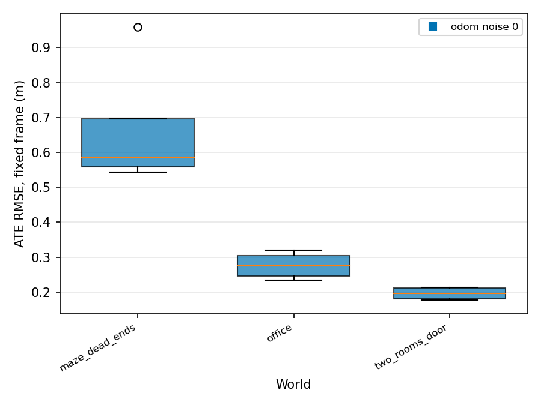
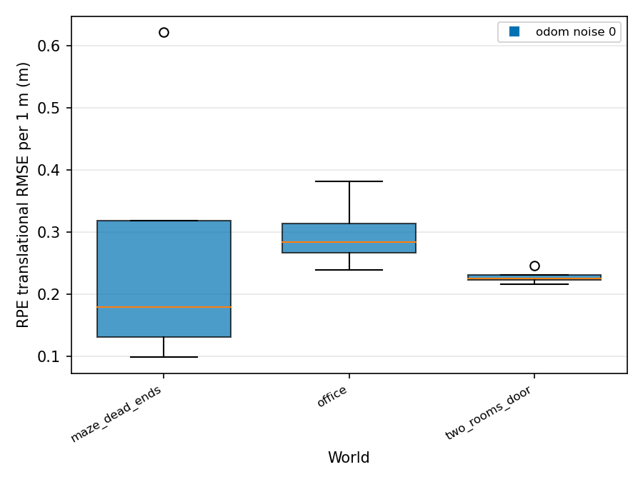
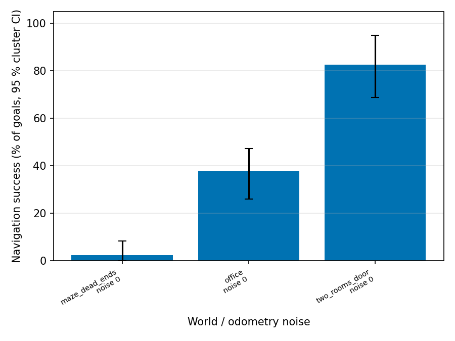
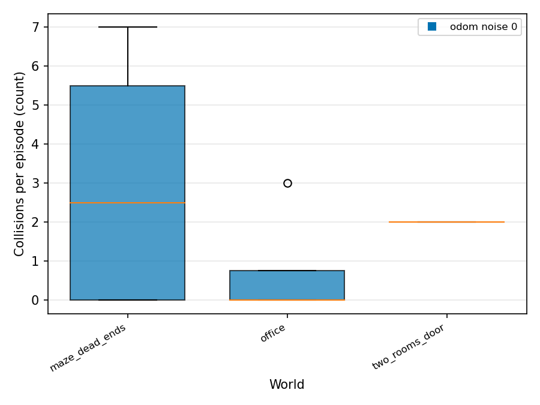

# Final results

Roots: `/home/hrishikesh/eval_runs/quick_navigation`

Unit of analysis is the episode (pre-registration 13.5). Statistics use status ok/partial episodes only. Mean ± sd, bootstrap CI (per world) or cluster bootstrap CI (pooled: worlds, then seeds). Rows with n < 3 are marked INSUFFICIENT DATA.

## Core metrics

### Coverage (explored) (`coverage_explored_pct`, %)

INSUFFICIENT DATA: metric not present in any aggregate.

### Coverage (cleaned, secondary) (`coverage_cleaned_pct`, %)

| experiment | world | noise | method | n | mean ± sd | 95 % boot CI | n_invalid | n_failed | note |
|---|---|---|---|---|---|---|---|---|---|
| quick_navigation | maze_dead_ends | 0 | scripted_goals | 4 | 7.3 ± 3.5 | [4.3, 10.4] | 0 | 0 |  |
| quick_navigation | office | 0 | scripted_goals | 4 | 13.5 ± 4.6 | [9.7, 17.0] | 0 | 0 |  |
| quick_navigation | two_rooms_door | 0 | scripted_goals | 4 | 27.9 ± 5.2 | [23.0, 32.0] | 0 | 0 |  |
| quick_navigation | **pooled** (3 worlds) | 0 | scripted_goals | 12 | 16.3 ± 9.9 | [7.6, 27.3] cluster | | |  |

### Steps: goals (`n_goals`, count)

| experiment | world | noise | method | n | mean ± sd | 95 % boot CI | n_invalid | n_failed | note |
|---|---|---|---|---|---|---|---|---|---|
| quick_navigation | maze_dead_ends | 0 | scripted_goals | 4 | 10.0 ± 3.4 | [8.0, 13.2] | 0 | 0 |  |
| quick_navigation | office | 0 | scripted_goals | 4 | 14.2 ± 4.0 | [11.0, 17.5] | 0 | 0 |  |
| quick_navigation | two_rooms_door | 0 | scripted_goals | 4 | 19.0 ± 0.0 | [19.0, 19.0] | 0 | 0 |  |
| quick_navigation | **pooled** (3 worlds) | 0 | scripted_goals | 12 | 14.4 ± 4.7 | [10.1, 19.0] cluster | | |  |

### Steps: command ticks (`n_cmd_ticks`, count)

| experiment | world | noise | method | n | mean ± sd | 95 % boot CI | n_invalid | n_failed | note |
|---|---|---|---|---|---|---|---|---|---|
| quick_navigation | maze_dead_ends | 0 | scripted_goals | 4 | 2065.5 ± 1203.8 | [1059.5, 3071.5] | 0 | 0 |  |
| quick_navigation | office | 0 | scripted_goals | 4 | 4194.2 ± 1554.9 | [2870.0, 5518.5] | 0 | 0 |  |
| quick_navigation | two_rooms_door | 0 | scripted_goals | 4 | 8542.0 ± 2667.2 | [6379.5, 11027.0] | 0 | 0 |  |
| quick_navigation | **pooled** (3 worlds) | 0 | scripted_goals | 12 | 4933.9 ± 3304.5 | [2182.9, 8249.6] cluster | | |  |

### Steps: recoveries (`n_recoveries`, count)

| experiment | world | noise | method | n | mean ± sd | 95 % boot CI | n_invalid | n_failed | note |
|---|---|---|---|---|---|---|---|---|---|
| quick_navigation | maze_dead_ends | 0 | scripted_goals | 4 | 167.5 ± 55.2 | [136.5, 221.8] | 0 | 0 |  |
| quick_navigation | office | 0 | scripted_goals | 4 | 167.2 ± 24.7 | [146.0, 188.5] | 0 | 0 |  |
| quick_navigation | two_rooms_door | 0 | scripted_goals | 4 | 108.0 ± 50.2 | [65.0, 151.0] | 0 | 0 |  |
| quick_navigation | **pooled** (3 worlds) | 0 | scripted_goals | 12 | 147.6 ± 50.4 | [107.0, 183.6] cluster | | |  |

### Total collisions (`n_collisions`, count)

| experiment | world | noise | method | n | mean ± sd | 95 % boot CI | n_invalid | n_failed | note |
|---|---|---|---|---|---|---|---|---|---|
| quick_navigation | maze_dead_ends | 0 | scripted_goals | 4 | 3.0 ± 3.6 | [0.0, 6.0] | 0 | 0 |  |
| quick_navigation | office | 0 | scripted_goals | 4 | 0.8 ± 1.5 | [0.0, 2.2] | 0 | 0 |  |
| quick_navigation | two_rooms_door | 0 | scripted_goals | 4 | 2.0 ± 0.0 | [2.0, 2.0] | 0 | 0 |  |
| quick_navigation | **pooled** (3 worlds) | 0 | scripted_goals | 12 | 1.9 ± 2.2 | [0.5, 3.7] cluster | | |  |

### Obstacle avoidance (`avoidance_pct`, %)

| experiment | world | noise | method | n | mean ± sd | 95 % boot CI | n_invalid | n_failed | note |
|---|---|---|---|---|---|---|---|---|---|
| quick_navigation | maze_dead_ends | 0 | scripted_goals | 0 | - | - | 0 | 0 | NO DATA |
| quick_navigation | office | 0 | scripted_goals | 4 | 98.8 ± 2.4 | [96.4, 100.0] | 0 | 0 |  |
| quick_navigation | two_rooms_door | 0 | scripted_goals | 4 | 87.5 ± 16.0 | [75.0, 100.0] | 0 | 0 |  |
| quick_navigation | **pooled** (2 worlds) | 0 | scripted_goals | 8 | 93.2 ± 12.2 | [81.2, 100.0] cluster | | |  |

### Responsiveness (`responsiveness_pct`, %)

| experiment | world | noise | method | n | mean ± sd | 95 % boot CI | n_invalid | n_failed | note |
|---|---|---|---|---|---|---|---|---|---|
| quick_navigation | maze_dead_ends | 0 | scripted_goals | 4 | 4.4 ± 5.4 | [0.0, 8.9] | 0 | 0 |  |
| quick_navigation | office | 0 | scripted_goals | 4 | 39.0 ± 24.2 | [22.5, 61.5] | 0 | 0 |  |
| quick_navigation | two_rooms_door | 0 | scripted_goals | 4 | 78.9 ± 18.2 | [60.5, 92.1] | 0 | 0 |  |
| quick_navigation | **pooled** (3 worlds) | 0 | scripted_goals | 12 | 40.8 ± 35.6 | [5.4, 77.2] cluster | | |  |

Pooled rate (`resp_n_met`):

| experiment | world | noise | method | events | episodes | pooled % | 95 % cluster CI | naive Wilson (ignores clustering) | n_invalid | n_failed |
|---|---|---|---|---|---|---|---|---|---|---|
| quick_navigation | maze_dead_ends | 0 | scripted_goals | 40 | 4 | 5.0 | [0.0, 8.6] | [1.4, 16.5] | 0 | 0 |
| quick_navigation | office | 0 | scripted_goals | 57 | 4 | 43.9 | [22.7, 65.7] | [31.8, 56.7] | 0 | 0 |
| quick_navigation | two_rooms_door | 0 | scripted_goals | 76 | 4 | 78.9 | [60.5, 92.1] | [68.5, 86.6] | 0 | 0 |

### ATE (fixed frame) (`ate_fixed_rmse_m`, m)

| experiment | world | noise | method | n | mean ± sd | 95 % boot CI | n_invalid | n_failed | note |
|---|---|---|---|---|---|---|---|---|---|
| quick_navigation | maze_dead_ends | 0 | scripted_goals | 4 | 0.669 ± 0.195 | [0.554, 0.860] | 0 | 0 |  |
| quick_navigation | office | 0 | scripted_goals | 4 | 0.276 ± 0.040 | [0.242, 0.309] | 0 | 0 |  |
| quick_navigation | two_rooms_door | 0 | scripted_goals | 4 | 0.196 ± 0.019 | [0.179, 0.212] | 0 | 0 |  |
| quick_navigation | **pooled** (3 worlds) | 0 | scripted_goals | 12 | 0.380 ± 0.240 | [0.199, 0.636] cluster | | |  |

### RPE (1 m) (`rpe_trans_rmse_m_1m`, m)

| experiment | world | noise | method | n | mean ± sd | 95 % boot CI | n_invalid | n_failed | note |
|---|---|---|---|---|---|---|---|---|---|
| quick_navigation | maze_dead_ends | 0 | scripted_goals | 4 | 0.270 ± 0.239 | [0.120, 0.502] | 0 | 0 |  |
| quick_navigation | office | 0 | scripted_goals | 4 | 0.297 ± 0.060 | [0.252, 0.355] | 0 | 0 |  |
| quick_navigation | two_rooms_door | 0 | scripted_goals | 4 | 0.229 ± 0.013 | [0.219, 0.241] | 0 | 0 |  |
| quick_navigation | **pooled** (3 worlds) | 0 | scripted_goals | 12 | 0.265 ± 0.132 | [0.195, 0.353] cluster | | |  |

### Map completeness (`map_completeness_pct`, %)

INSUFFICIENT DATA: metric not present in any aggregate.

### Avoidance trial success (`avoid_trial_success_pct`, %)

INSUFFICIENT DATA: metric not present in any aggregate.

### Navigation success (GT) (`nav_success_gt_pct`, %)

| experiment | world | noise | method | n | mean ± sd | 95 % boot CI | n_invalid | n_failed | note |
|---|---|---|---|---|---|---|---|---|---|
| quick_navigation | maze_dead_ends | 0 | scripted_goals | 4 | 2.8 ± 5.6 | [0.0, 8.3] | 0 | 0 |  |
| quick_navigation | office | 0 | scripted_goals | 4 | 18.8 ± 12.5 | [6.2, 25.0] | 0 | 0 |  |
| quick_navigation | two_rooms_door | 0 | scripted_goals | 4 | 48.8 ± 11.8 | [40.0, 58.8] | 0 | 0 |  |
| quick_navigation | **pooled** (3 worlds) | 0 | scripted_goals | 12 | 23.4 ± 22.0 | [2.8, 46.7] cluster | | |  |

Pooled rate (`nav_goals_succeeded`):

| experiment | world | noise | method | events | episodes | pooled % | 95 % cluster CI | naive Wilson (ignores clustering) | n_invalid | n_failed |
|---|---|---|---|---|---|---|---|---|---|---|
| quick_navigation | maze_dead_ends | 0 | scripted_goals | 40 | 4 | 2.5 | [0.0, 8.3] | [0.4, 12.9] | 0 | 0 |
| quick_navigation | office | 0 | scripted_goals | 58 | 4 | 37.9 | [26.1, 47.2] | [26.6, 50.8] | 0 | 0 |
| quick_navigation | two_rooms_door | 0 | scripted_goals | 80 | 4 | 82.5 | [68.8, 95.0] | [72.7, 89.3] | 0 | 0 |

### Loop closure precision (`lc_precision_pct`, %)

INSUFFICIENT DATA: metric not present in any aggregate.

### Loop closure recall (`lc_recall_pct`, %)

INSUFFICIENT DATA: metric not present in any aggregate.

### Path length ratio (`path_length_ratio_mean`, -)

| experiment | world | noise | method | n | mean ± sd | 95 % boot CI | n_invalid | n_failed | note |
|---|---|---|---|---|---|---|---|---|---|
| quick_navigation | maze_dead_ends | 0 | scripted_goals | 1 | 1.087 ± - | [-, -] | 0 | 0 | INSUFFICIENT DATA (n<3) |
| quick_navigation | office | 0 | scripted_goals | 4 | 1.188 ± 0.050 | [1.145, 1.228] | 0 | 0 |  |
| quick_navigation | two_rooms_door | 0 | scripted_goals | 4 | 1.261 ± 0.094 | [1.184, 1.337] | 0 | 0 |  |
| quick_navigation | **pooled** (3 worlds) | 0 | scripted_goals | 9 | 1.209 ± 0.088 | [1.087, 1.273] cluster | | |  |

### Cleaning efficiency (secondary) (`cleaning_efficiency`, -)

| experiment | world | noise | method | n | mean ± sd | 95 % boot CI | n_invalid | n_failed | note |
|---|---|---|---|---|---|---|---|---|---|
| quick_navigation | maze_dead_ends | 0 | scripted_goals | 4 | 0.063 ± 0.025 | [0.042, 0.084] | 0 | 0 |  |
| quick_navigation | office | 0 | scripted_goals | 4 | 0.096 ± 0.035 | [0.065, 0.128] | 0 | 0 |  |
| quick_navigation | two_rooms_door | 0 | scripted_goals | 4 | 0.148 ± 0.017 | [0.132, 0.162] | 0 | 0 |  |
| quick_navigation | **pooled** (3 worlds) | 0 | scripted_goals | 12 | 0.103 ± 0.044 | [0.063, 0.146] cluster | | |  |

## Additional metrics (A1-A15)

### A1 Time to 50 % explored (`t_to_50_explored_s`, s)

INSUFFICIENT DATA: metric not present in any aggregate.

### A1 Explored AUC (`coverage_explored_auc`, %)

INSUFFICIENT DATA: metric not present in any aggregate.

### A2 Overlap ratio (`overlap_ratio`, -)

| experiment | world | noise | method | n | mean ± sd | 95 % boot CI | n_invalid | n_failed | note |
|---|---|---|---|---|---|---|---|---|---|
| quick_navigation | maze_dead_ends | 0 | scripted_goals | 4 | 1.128 ± 0.179 | [1.012, 1.298] | 0 | 0 |  |
| quick_navigation | office | 0 | scripted_goals | 4 | 1.418 ± 0.175 | [1.290, 1.573] | 0 | 0 |  |
| quick_navigation | two_rooms_door | 0 | scripted_goals | 4 | 1.880 ± 0.267 | [1.673, 2.097] | 0 | 0 |  |
| quick_navigation | **pooled** (3 worlds) | 0 | scripted_goals | 12 | 1.475 ± 0.376 | [1.143, 1.839] cluster | | |  |

### A3 Missed area (`missed_area_m2`, m2)

| experiment | world | noise | method | n | mean ± sd | 95 % boot CI | n_invalid | n_failed | note |
|---|---|---|---|---|---|---|---|---|---|
| quick_navigation | maze_dead_ends | 0 | scripted_goals | 4 | 38.344 ± 1.468 | [37.085, 39.603] | 0 | 0 |  |
| quick_navigation | office | 0 | scripted_goals | 4 | 33.869 ± 1.791 | [32.499, 35.357] | 0 | 0 |  |
| quick_navigation | two_rooms_door | 0 | scripted_goals | 4 | 22.749 ± 1.641 | [21.454, 24.313] | 0 | 0 |  |
| quick_navigation | **pooled** (3 worlds) | 0 | scripted_goals | 12 | 31.654 ± 7.006 | [22.957, 38.106] cluster | | |  |

### A4 Distance (GT) (`distance_gt_m`, m)

| experiment | world | noise | method | n | mean ± sd | 95 % boot CI | n_invalid | n_failed | note |
|---|---|---|---|---|---|---|---|---|---|
| quick_navigation | maze_dead_ends | 0 | scripted_goals | 4 | 14.374 ± 8.760 | [7.143, 21.604] | 0 | 0 |  |
| quick_navigation | office | 0 | scripted_goals | 4 | 30.904 ± 11.353 | [21.451, 40.358] | 0 | 0 |  |
| quick_navigation | two_rooms_door | 0 | scripted_goals | 4 | 69.079 ± 21.719 | [51.723, 87.783] | 0 | 0 |  |
| quick_navigation | **pooled** (3 worlds) | 0 | scripted_goals | 12 | 38.119 ± 27.518 | [15.223, 66.223] cluster | | |  |

### A4 Energy proxy (`energy_proxy_m2ps`, m2/s)

| experiment | world | noise | method | n | mean ± sd | 95 % boot CI | n_invalid | n_failed | note |
|---|---|---|---|---|---|---|---|---|---|
| quick_navigation | maze_dead_ends | 0 | scripted_goals | 4 | 7.625 ± 4.332 | [4.098, 11.151] | 0 | 0 |  |
| quick_navigation | office | 0 | scripted_goals | 4 | 15.686 ± 5.967 | [10.890, 20.482] | 0 | 0 |  |
| quick_navigation | two_rooms_door | 0 | scripted_goals | 4 | 35.793 ± 11.277 | [27.084, 45.484] | 0 | 0 |  |
| quick_navigation | **pooled** (3 worlds) | 0 | scripted_goals | 12 | 19.701 ± 14.233 | [7.917, 34.246] cluster | | |  |

### A5 Min clearance (`min_clearance_m`, m)

| experiment | world | noise | method | n | mean ± sd | 95 % boot CI | n_invalid | n_failed | note |
|---|---|---|---|---|---|---|---|---|---|
| quick_navigation | maze_dead_ends | 0 | scripted_goals | 4 | 0.036 ± 0.053 | [0.000, 0.084] | 0 | 0 |  |
| quick_navigation | office | 0 | scripted_goals | 4 | 0.099 ± 0.113 | [0.021, 0.204] | 0 | 0 |  |
| quick_navigation | two_rooms_door | 0 | scripted_goals | 4 | 0.000 ± 0.000 | [0.000, 0.000] | 0 | 0 |  |
| quick_navigation | **pooled** (3 worlds) | 0 | scripted_goals | 12 | 0.045 ± 0.078 | [0.000, 0.110] cluster | | |  |

### A8 Planning latency (`plan_latency_ms_mean`, ms)

| experiment | world | noise | method | n | mean ± sd | 95 % boot CI | n_invalid | n_failed | note |
|---|---|---|---|---|---|---|---|---|---|
| quick_navigation | maze_dead_ends | 0 | scripted_goals | 4 | 26050.9 ± 20118.1 | [8172.0, 41931.2] | 0 | 0 |  |
| quick_navigation | office | 0 | scripted_goals | 4 | 684.2 ± 574.3 | [201.0, 1167.5] | 0 | 0 |  |
| quick_navigation | two_rooms_door | 0 | scripted_goals | 4 | 1196.8 ± 1127.3 | [507.0, 2289.4] | 0 | 0 |  |
| quick_navigation | **pooled** (3 worlds) | 0 | scripted_goals | 12 | 9310.6 ± 16239.6 | [581.8, 25251.1] cluster | | |  |

### A9 Path smoothness (`smooth_curvature_rms_1pm`, 1/m)

| experiment | world | noise | method | n | mean ± sd | 95 % boot CI | n_invalid | n_failed | note |
|---|---|---|---|---|---|---|---|---|---|
| quick_navigation | maze_dead_ends | 0 | scripted_goals | 4 | 1.957 ± 1.152 | [0.818, 2.886] | 0 | 0 |  |
| quick_navigation | office | 0 | scripted_goals | 4 | 3.784 ± 1.071 | [2.906, 4.662] | 0 | 0 |  |
| quick_navigation | two_rooms_door | 0 | scripted_goals | 4 | 3.286 ± 0.400 | [2.968, 3.674] | 0 | 0 |  |
| quick_navigation | **pooled** (3 worlds) | 0 | scripted_goals | 12 | 3.009 ± 1.169 | [1.966, 3.864] cluster | | |  |

### A10 Odometry drift ratio (`odom_drift_ratio`, -)

| experiment | world | noise | method | n | mean ± sd | 95 % boot CI | n_invalid | n_failed | note |
|---|---|---|---|---|---|---|---|---|---|
| quick_navigation | maze_dead_ends | 0 | scripted_goals | 4 | 0.049 ± 0.073 | [0.009, 0.122] | 0 | 0 |  |
| quick_navigation | office | 0 | scripted_goals | 4 | 0.014 ± 0.009 | [0.007, 0.021] | 0 | 0 |  |
| quick_navigation | two_rooms_door | 0 | scripted_goals | 4 | 0.011 ± 0.007 | [0.007, 0.019] | 0 | 0 |  |
| quick_navigation | **pooled** (3 worlds) | 0 | scripted_goals | 12 | 0.025 ± 0.042 | [0.009, 0.061] cluster | | |  |

### A12 True RTF (`rtf_true_mean`, -)

| experiment | world | noise | method | n | mean ± sd | 95 % boot CI | n_invalid | n_failed | note |
|---|---|---|---|---|---|---|---|---|---|
| quick_navigation | maze_dead_ends | 0 | scripted_goals | 4 | 1.000 ± 0.000 | [1.000, 1.000] | 0 | 0 |  |
| quick_navigation | office | 0 | scripted_goals | 4 | 1.000 ± 0.000 | [1.000, 1.000] | 0 | 0 |  |
| quick_navigation | two_rooms_door | 0 | scripted_goals | 4 | 1.000 ± 0.000 | [1.000, 1.000] | 0 | 0 |  |
| quick_navigation | **pooled** (3 worlds) | 0 | scripted_goals | 12 | 1.000 ± 0.000 | [1.000, 1.000] cluster | | |  |

### A14 AMCL localization error (`loc_error_mean_m`, m)

| experiment | world | noise | method | n | mean ± sd | 95 % boot CI | n_invalid | n_failed | note |
|---|---|---|---|---|---|---|---|---|---|
| quick_navigation | maze_dead_ends | 0 | scripted_goals | 4 | 0.514 ± 0.063 | [0.461, 0.567] | 0 | 0 |  |
| quick_navigation | office | 0 | scripted_goals | 4 | 0.259 ± 0.037 | [0.229, 0.290] | 0 | 0 |  |
| quick_navigation | two_rooms_door | 0 | scripted_goals | 4 | 0.180 ± 0.017 | [0.165, 0.194] | 0 | 0 |  |
| quick_navigation | **pooled** (3 worlds) | 0 | scripted_goals | 12 | 0.318 ± 0.154 | [0.183, 0.509] cluster | | |  |

## Method comparisons (Holm-adjusted across the family)

No method comparisons in the data (method comparison is on hold).

## Figures

Metrics with no data: `coverage_explored_pct`, `map_completeness_pct`, `avoid_trial_success_pct`, `lc_precision_pct`, `lc_recall_pct`, `t_to_50_explored_s`, `coverage_explored_auc`

## Metric health

Per-episode classification (precedence UNMEASURABLE > SUSPECT > LOW_N > BAD > OK). BAD floors are pre-registered diagnosis triggers, not exclusions.

| metric | OK | LOW_N | UNMEASURABLE | SUSPECT | BAD | NA | top reasons | fallback to report |
|---|---|---|---|---|---|---|---|---|
| `coverage_explored_pct` | 0 | 0 | 12 | 0 | 0 | 0 | NO_DATA x12 | - |
| `n_goals` | 12 | 0 | 0 | 0 | 0 | 0 | - | - |
| `n_collisions` | 12 | 0 | 0 | 0 | 0 | 0 | - | - |
| `avoidance_pct` | 7 | 0 | 4 | 0 | 1 | 0 | NO_EVENTS x4, BELOW_FLOOR x1 | - |
| `responsiveness_pct` | 9 | 3 | 0 | 0 | 0 | 0 | LOW_N x3 | - |
| `ate_fixed_rmse_m` | 3 | 0 | 0 | 8 | 1 | 0 | FRAME_OFFSET x7, BELOW_FLOOR x5, ODOM_CORRUPTED x4 | `ate_fixed_rmse_m_pre_corrupt` |
| `rpe_trans_rmse_m_1m` | 8 | 0 | 0 | 4 | 0 | 0 | ODOM_CORRUPTED x4 | `rpe_trans_rmse_m_5s` |
| `map_completeness_pct` | 0 | 0 | 12 | 0 | 0 | 0 | MAP_MISSING x12 | - |
| `trial_success` | 0 | 0 | 0 | 0 | 0 | 12 | - | - |
| `nav_success_gt_pct` | 2 | 0 | 0 | 1 | 9 | 0 | BELOW_FLOOR x10, NAV_GT_DIVERGENCE x1 | `nav_success_pct (Nav2-reported)` |
| `lc_precision_pct` | 0 | 0 | 12 | 0 | 0 | 0 | NO_EVENTS x12 | - |
| `lc_recall_pct` | 0 | 0 | 12 | 0 | 0 | 0 | NO_EVENTS x12 | - |
| `path_length_ratio_mean` | 6 | 3 | 3 | 0 | 0 | 0 | LOW_N x3, NO_EVENTS x3 | - |
| `cleaning_efficiency` | 12 | 0 | 0 | 0 | 0 | 0 | - | - |

## Reported regardless of outcome (pre-registration 13.5b)

| experiment | world | noise | ok | partial | invalid | failed | total |
|---|---|---|---|---|---|---|---|
| quick_navigation | maze_dead_ends | 0 | 4 | 0 | 0 | 0 | 4 |
| quick_navigation | office | 0 | 4 | 0 | 0 | 0 | 4 |
| quick_navigation | two_rooms_door | 0 | 4 | 0 | 0 | 0 | 4 |

Totals: ok=12

### Deviations from the pre-registration

None recorded (no deviations.md in the given roots). Check batch_manifest.json git commit against the frozen document.

Unfavourable results and negative loop-closure results are shown in the tables above without filtering.

