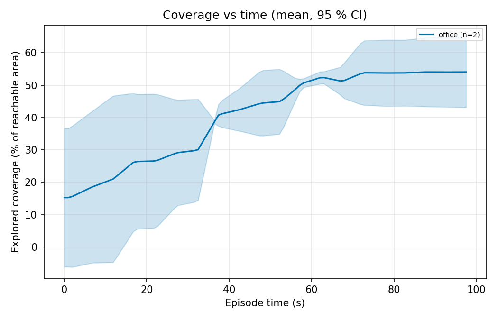
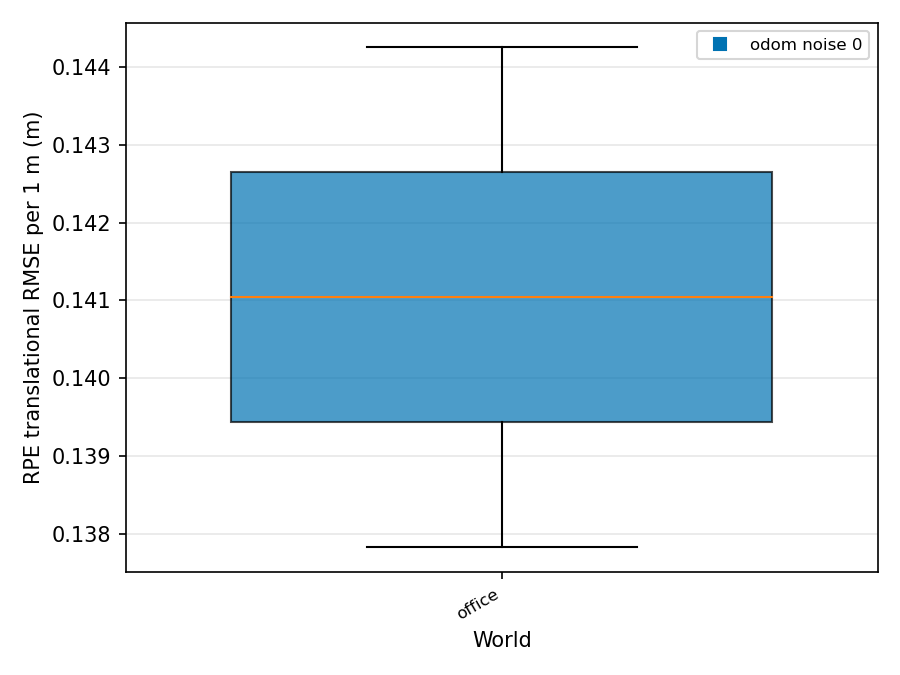
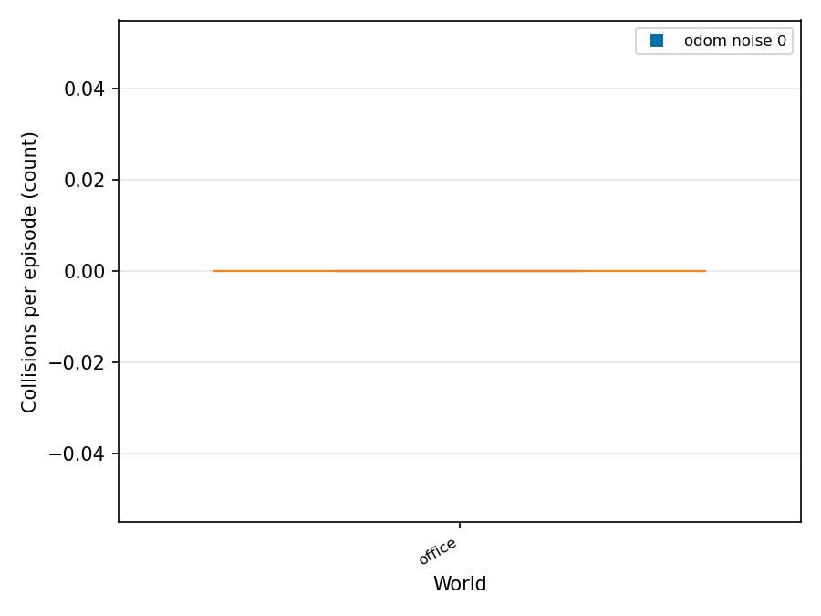

# Final results

Roots: `/home/hrishikesh/eval_runs/quick_responsiveness`

Unit of analysis is the episode (pre-registration 13.5). Statistics use status ok/partial episodes only. Mean ± sd, bootstrap CI (per world) or cluster bootstrap CI (pooled: worlds, then seeds). Rows with n < 3 are marked INSUFFICIENT DATA.

## Core metrics

### Coverage (explored) (`coverage_explored_pct`, %)

| experiment | world | noise | method | n | mean ± sd | 95 % boot CI | n_invalid | n_failed | note |
|---|---|---|---|---|---|---|---|---|---|
| quick_responsiveness | office | 0 | responsiveness | 2 | 54.1 ± 7.9 | [48.5, 59.7] | 2 | 0 | INSUFFICIENT DATA (n<3) |
| quick_responsiveness | **pooled** (1 worlds) | 0 | responsiveness | 2 | 54.1 ± 7.9 | [48.5, 59.7] cluster | | | INSUFFICIENT DATA (n<3) |

### Coverage (cleaned, secondary) (`coverage_cleaned_pct`, %)

| experiment | world | noise | method | n | mean ± sd | 95 % boot CI | n_invalid | n_failed | note |
|---|---|---|---|---|---|---|---|---|---|
| quick_responsiveness | office | 0 | responsiveness | 2 | 0.7 ± 0.0 | [0.7, 0.7] | 2 | 0 | INSUFFICIENT DATA (n<3) |
| quick_responsiveness | **pooled** (1 worlds) | 0 | responsiveness | 2 | 0.7 ± 0.0 | [0.7, 0.7] cluster | | | INSUFFICIENT DATA (n<3) |

### Steps: goals (`n_goals`, count)

| experiment | world | noise | method | n | mean ± sd | 95 % boot CI | n_invalid | n_failed | note |
|---|---|---|---|---|---|---|---|---|---|
| quick_responsiveness | office | 0 | responsiveness | 2 | 0.0 ± 0.0 | [0.0, 0.0] | 2 | 0 | INSUFFICIENT DATA (n<3) |
| quick_responsiveness | **pooled** (1 worlds) | 0 | responsiveness | 2 | 0.0 ± 0.0 | [0.0, 0.0] cluster | | | INSUFFICIENT DATA (n<3) |

### Steps: command ticks (`n_cmd_ticks`, count)

| experiment | world | noise | method | n | mean ± sd | 95 % boot CI | n_invalid | n_failed | note |
|---|---|---|---|---|---|---|---|---|---|
| quick_responsiveness | office | 0 | responsiveness | 2 | 420.0 ± 0.0 | [420.0, 420.0] | 2 | 0 | INSUFFICIENT DATA (n<3) |
| quick_responsiveness | **pooled** (1 worlds) | 0 | responsiveness | 2 | 420.0 ± 0.0 | [420.0, 420.0] cluster | | | INSUFFICIENT DATA (n<3) |

### Steps: recoveries (`n_recoveries`, count)

| experiment | world | noise | method | n | mean ± sd | 95 % boot CI | n_invalid | n_failed | note |
|---|---|---|---|---|---|---|---|---|---|
| quick_responsiveness | office | 0 | responsiveness | 2 | 0.0 ± 0.0 | [0.0, 0.0] | 2 | 0 | INSUFFICIENT DATA (n<3) |
| quick_responsiveness | **pooled** (1 worlds) | 0 | responsiveness | 2 | 0.0 ± 0.0 | [0.0, 0.0] cluster | | | INSUFFICIENT DATA (n<3) |

### Total collisions (`n_collisions`, count)

| experiment | world | noise | method | n | mean ± sd | 95 % boot CI | n_invalid | n_failed | note |
|---|---|---|---|---|---|---|---|---|---|
| quick_responsiveness | office | 0 | responsiveness | 2 | 0.0 ± 0.0 | [0.0, 0.0] | 2 | 0 | INSUFFICIENT DATA (n<3) |
| quick_responsiveness | **pooled** (1 worlds) | 0 | responsiveness | 2 | 0.0 ± 0.0 | [0.0, 0.0] cluster | | | INSUFFICIENT DATA (n<3) |

### Obstacle avoidance (`avoidance_pct`, %)

| experiment | world | noise | method | n | mean ± sd | 95 % boot CI | n_invalid | n_failed | note |
|---|---|---|---|---|---|---|---|---|---|
| quick_responsiveness | office | 0 | responsiveness | 1 | 100.0 ± - | [-, -] | 2 | 0 | INSUFFICIENT DATA (n<3) |
| quick_responsiveness | **pooled** (1 worlds) | 0 | responsiveness | 1 | 100.0 ± - | [100.0, 100.0] cluster | | | INSUFFICIENT DATA (n<3) |

### Responsiveness (`responsiveness_pct`, %)

| experiment | world | noise | method | n | mean ± sd | 95 % boot CI | n_invalid | n_failed | note |
|---|---|---|---|---|---|---|---|---|---|
| quick_responsiveness | office | 0 | responsiveness | 2 | 100.0 ± 0.0 | [100.0, 100.0] | 2 | 0 | INSUFFICIENT DATA (n<3) |
| quick_responsiveness | **pooled** (1 worlds) | 0 | responsiveness | 2 | 100.0 ± 0.0 | [100.0, 100.0] cluster | | | INSUFFICIENT DATA (n<3) |

Pooled rate (`resp_n_met`):

| experiment | world | noise | method | events | episodes | pooled % | 95 % cluster CI | naive Wilson (ignores clustering) | n_invalid | n_failed |
|---|---|---|---|---|---|---|---|---|---|---|
| quick_responsiveness | office | 0 | responsiveness | 80 | 2 | 100.0 | [100.0, 100.0] | [95.4, 100.0] | 2 | 0 |

### ATE (fixed frame) (`ate_fixed_rmse_m`, m)

| experiment | world | noise | method | n | mean ± sd | 95 % boot CI | n_invalid | n_failed | note |
|---|---|---|---|---|---|---|---|---|---|
| quick_responsiveness | office | 0 | responsiveness | 2 | 0.110 ± 0.001 | [0.110, 0.111] | 2 | 0 | INSUFFICIENT DATA (n<3) |
| quick_responsiveness | **pooled** (1 worlds) | 0 | responsiveness | 2 | 0.110 ± 0.001 | [0.110, 0.111] cluster | | | INSUFFICIENT DATA (n<3) |

### RPE (1 m) (`rpe_trans_rmse_m_1m`, m)

| experiment | world | noise | method | n | mean ± sd | 95 % boot CI | n_invalid | n_failed | note |
|---|---|---|---|---|---|---|---|---|---|
| quick_responsiveness | office | 0 | responsiveness | 2 | 0.141 ± 0.005 | [0.138, 0.144] | 2 | 0 | INSUFFICIENT DATA (n<3) |
| quick_responsiveness | **pooled** (1 worlds) | 0 | responsiveness | 2 | 0.141 ± 0.005 | [0.138, 0.144] cluster | | | INSUFFICIENT DATA (n<3) |

### Map completeness (`map_completeness_pct`, %)

| experiment | world | noise | method | n | mean ± sd | 95 % boot CI | n_invalid | n_failed | note |
|---|---|---|---|---|---|---|---|---|---|
| quick_responsiveness | office | 0 | responsiveness | 2 | 38.3 ± 6.3 | [33.9, 42.8] | 2 | 0 | INSUFFICIENT DATA (n<3) |
| quick_responsiveness | **pooled** (1 worlds) | 0 | responsiveness | 2 | 38.3 ± 6.3 | [33.9, 42.8] cluster | | | INSUFFICIENT DATA (n<3) |

### Avoidance trial success (`avoid_trial_success_pct`, %)

INSUFFICIENT DATA: metric not present in any aggregate.

### Navigation success (GT) (`nav_success_gt_pct`, %)

INSUFFICIENT DATA: metric not present in any aggregate.

### Loop closure precision (`lc_precision_pct`, %)

| experiment | world | noise | method | n | mean ± sd | 95 % boot CI | n_invalid | n_failed | note |
|---|---|---|---|---|---|---|---|---|---|
| quick_responsiveness | office | 0 | responsiveness | 2 | 76.3 ± 10.0 | [69.2, 83.3] | 2 | 0 | INSUFFICIENT DATA (n<3) |
| quick_responsiveness | **pooled** (1 worlds) | 0 | responsiveness | 2 | 76.3 ± 10.0 | [69.2, 83.3] cluster | | | INSUFFICIENT DATA (n<3) |

Pooled rate (`lc_n_true`):

| experiment | world | noise | method | events | episodes | pooled % | 95 % cluster CI | naive Wilson (ignores clustering) | n_invalid | n_failed |
|---|---|---|---|---|---|---|---|---|---|---|
| quick_responsiveness | office | 0 | responsiveness | 56 | 2 | 76.8 | [69.2, 83.3] | [64.2, 85.9] | 2 | 0 |

### Loop closure recall (`lc_recall_pct`, %)

| experiment | world | noise | method | n | mean ± sd | 95 % boot CI | n_invalid | n_failed | note |
|---|---|---|---|---|---|---|---|---|---|
| quick_responsiveness | office | 0 | responsiveness | 2 | 100.0 ± 0.0 | [100.0, 100.0] | 2 | 0 | INSUFFICIENT DATA (n<3) |
| quick_responsiveness | **pooled** (1 worlds) | 0 | responsiveness | 2 | 100.0 ± 0.0 | [100.0, 100.0] cluster | | | INSUFFICIENT DATA (n<3) |

### Path length ratio (`path_length_ratio_mean`, -)

INSUFFICIENT DATA: metric not present in any aggregate.

### Cleaning efficiency (secondary) (`cleaning_efficiency`, -)

| experiment | world | noise | method | n | mean ± sd | 95 % boot CI | n_invalid | n_failed | note |
|---|---|---|---|---|---|---|---|---|---|
| quick_responsiveness | office | 0 | responsiveness | 2 | 0.002 ± 0.000 | [0.002, 0.002] | 2 | 0 | INSUFFICIENT DATA (n<3) |
| quick_responsiveness | **pooled** (1 worlds) | 0 | responsiveness | 2 | 0.002 ± 0.000 | [0.002, 0.002] cluster | | | INSUFFICIENT DATA (n<3) |

## Additional metrics (A1-A15)

### A1 Time to 50 % explored (`t_to_50_explored_s`, s)

| experiment | world | noise | method | n | mean ± sd | 95 % boot CI | n_invalid | n_failed | note |
|---|---|---|---|---|---|---|---|---|---|
| quick_responsiveness | office | 0 | responsiveness | 2 | 59.3 ± 4.8 | [55.9, 62.7] | 2 | 0 | INSUFFICIENT DATA (n<3) |
| quick_responsiveness | **pooled** (1 worlds) | 0 | responsiveness | 2 | 59.3 ± 4.8 | [55.9, 62.7] cluster | | | INSUFFICIENT DATA (n<3) |

### A1 Explored AUC (`coverage_explored_auc`, %)

| experiment | world | noise | method | n | mean ± sd | 95 % boot CI | n_invalid | n_failed | note |
|---|---|---|---|---|---|---|---|---|---|
| quick_responsiveness | office | 0 | responsiveness | 2 | 40.6 ± 1.8 | [39.3, 41.9] | 2 | 0 | INSUFFICIENT DATA (n<3) |
| quick_responsiveness | **pooled** (1 worlds) | 0 | responsiveness | 2 | 40.6 ± 1.8 | [39.3, 41.9] cluster | | | INSUFFICIENT DATA (n<3) |

### A2 Overlap ratio (`overlap_ratio`, -)

| experiment | world | noise | method | n | mean ± sd | 95 % boot CI | n_invalid | n_failed | note |
|---|---|---|---|---|---|---|---|---|---|
| quick_responsiveness | office | 0 | responsiveness | 2 | 3.829 ± 0.052 | [3.792, 3.865] | 2 | 0 | INSUFFICIENT DATA (n<3) |
| quick_responsiveness | **pooled** (1 worlds) | 0 | responsiveness | 2 | 3.829 ± 0.052 | [3.792, 3.865] cluster | | | INSUFFICIENT DATA (n<3) |

### A3 Missed area (`missed_area_m2`, m2)

| experiment | world | noise | method | n | mean ± sd | 95 % boot CI | n_invalid | n_failed | note |
|---|---|---|---|---|---|---|---|---|---|
| quick_responsiveness | office | 0 | responsiveness | 2 | 38.908 ± 0.004 | [38.905, 38.910] | 2 | 0 | INSUFFICIENT DATA (n<3) |
| quick_responsiveness | **pooled** (1 worlds) | 0 | responsiveness | 2 | 38.908 ± 0.004 | [38.905, 38.910] cluster | | | INSUFFICIENT DATA (n<3) |

### A4 Distance (GT) (`distance_gt_m`, m)

| experiment | world | noise | method | n | mean ± sd | 95 % boot CI | n_invalid | n_failed | note |
|---|---|---|---|---|---|---|---|---|---|
| quick_responsiveness | office | 0 | responsiveness | 2 | 4.116 ± 0.006 | [4.111, 4.120] | 2 | 0 | INSUFFICIENT DATA (n<3) |
| quick_responsiveness | **pooled** (1 worlds) | 0 | responsiveness | 2 | 4.116 ± 0.006 | [4.111, 4.120] cluster | | | INSUFFICIENT DATA (n<3) |

### A4 Energy proxy (`energy_proxy_m2ps`, m2/s)

| experiment | world | noise | method | n | mean ± sd | 95 % boot CI | n_invalid | n_failed | note |
|---|---|---|---|---|---|---|---|---|---|
| quick_responsiveness | office | 0 | responsiveness | 2 | 1.469 ± 0.004 | [1.466, 1.472] | 2 | 0 | INSUFFICIENT DATA (n<3) |
| quick_responsiveness | **pooled** (1 worlds) | 0 | responsiveness | 2 | 1.469 ± 0.004 | [1.466, 1.472] cluster | | | INSUFFICIENT DATA (n<3) |

### A5 Min clearance (`min_clearance_m`, m)

| experiment | world | noise | method | n | mean ± sd | 95 % boot CI | n_invalid | n_failed | note |
|---|---|---|---|---|---|---|---|---|---|
| quick_responsiveness | office | 0 | responsiveness | 2 | 0.480 ± 0.144 | [0.378, 0.582] | 2 | 0 | INSUFFICIENT DATA (n<3) |
| quick_responsiveness | **pooled** (1 worlds) | 0 | responsiveness | 2 | 0.480 ± 0.144 | [0.378, 0.582] cluster | | | INSUFFICIENT DATA (n<3) |

### A8 Planning latency (`plan_latency_ms_mean`, ms)

INSUFFICIENT DATA: metric not present in any aggregate.

### A9 Path smoothness (`smooth_curvature_rms_1pm`, 1/m)

| experiment | world | noise | method | n | mean ± sd | 95 % boot CI | n_invalid | n_failed | note |
|---|---|---|---|---|---|---|---|---|---|
| quick_responsiveness | office | 0 | responsiveness | 2 | 0.000 ± 0.000 | [0.000, 0.000] | 2 | 0 | INSUFFICIENT DATA (n<3) |
| quick_responsiveness | **pooled** (1 worlds) | 0 | responsiveness | 2 | 0.000 ± 0.000 | [0.000, 0.000] cluster | | | INSUFFICIENT DATA (n<3) |

### A10 Odometry drift ratio (`odom_drift_ratio`, -)

| experiment | world | noise | method | n | mean ± sd | 95 % boot CI | n_invalid | n_failed | note |
|---|---|---|---|---|---|---|---|---|---|
| quick_responsiveness | office | 0 | responsiveness | 2 | 0.024 ± 0.000 | [0.024, 0.024] | 2 | 0 | INSUFFICIENT DATA (n<3) |
| quick_responsiveness | **pooled** (1 worlds) | 0 | responsiveness | 2 | 0.024 ± 0.000 | [0.024, 0.024] cluster | | | INSUFFICIENT DATA (n<3) |

### A12 True RTF (`rtf_true_mean`, -)

| experiment | world | noise | method | n | mean ± sd | 95 % boot CI | n_invalid | n_failed | note |
|---|---|---|---|---|---|---|---|---|---|
| quick_responsiveness | office | 0 | responsiveness | 2 | 0.981 ± 0.026 | [0.963, 1.000] | 2 | 0 | INSUFFICIENT DATA (n<3) |
| quick_responsiveness | **pooled** (1 worlds) | 0 | responsiveness | 2 | 0.981 ± 0.026 | [0.963, 1.000] cluster | | | INSUFFICIENT DATA (n<3) |

### A14 AMCL localization error (`loc_error_mean_m`, m)

INSUFFICIENT DATA: metric not present in any aggregate.

## Method comparisons (Holm-adjusted across the family)

No method comparisons in the data (method comparison is on hold).

## Figures

Metrics with no data: `avoid_trial_success_pct`, `nav_success_gt_pct`, `path_length_ratio_mean`, `plan_latency_ms_mean`, `loc_error_mean_m`

## Metric health

Per-episode classification (precedence UNMEASURABLE > SUSPECT > LOW_N > BAD > OK). BAD floors are pre-registered diagnosis triggers, not exclusions.

| metric | OK | LOW_N | UNMEASURABLE | SUSPECT | BAD | NA | top reasons | fallback to report |
|---|---|---|---|---|---|---|---|---|
| `coverage_explored_pct` | 0 | 0 | 2 | 0 | 2 | 0 | INVALID_EPISODE x2, BELOW_FLOOR x2 | - |
| `n_goals` | 2 | 0 | 2 | 0 | 0 | 0 | INVALID_EPISODE x2 | - |
| `n_collisions` | 2 | 0 | 2 | 0 | 0 | 0 | INVALID_EPISODE x2 | - |
| `avoidance_pct` | 0 | 1 | 3 | 0 | 0 | 0 | INVALID_EPISODE x2, NO_EVENTS x2, LOW_N x2 | - |
| `responsiveness_pct` | 2 | 0 | 2 | 0 | 0 | 0 | INVALID_EPISODE x2 | - |
| `ate_fixed_rmse_m` | 2 | 0 | 2 | 0 | 0 | 0 | INVALID_EPISODE x2 | `ate_fixed_rmse_m_pre_corrupt` |
| `rpe_trans_rmse_m_1m` | 2 | 0 | 2 | 0 | 0 | 0 | INVALID_EPISODE x2 | `rpe_trans_rmse_m_5s` |
| `map_completeness_pct` | 0 | 0 | 2 | 0 | 2 | 0 | INVALID_EPISODE x2, MAP_MISSING x2, BELOW_FLOOR x2 | - |
| `trial_success` | 0 | 0 | 0 | 0 | 0 | 4 | - | - |
| `nav_success_gt_pct` | 0 | 0 | 4 | 0 | 0 | 0 | NO_EVENTS x4, INVALID_EPISODE x2 | - |
| `lc_precision_pct` | 2 | 0 | 2 | 0 | 0 | 0 | INVALID_EPISODE x2, NO_EVENTS x2 | `lc_precision_samepose_pct`, `lc_precision_loose_pct` |
| `lc_recall_pct` | 0 | 2 | 2 | 0 | 0 | 0 | INVALID_EPISODE x2, NO_EVENTS x2, LOW_N x2 | - |
| `path_length_ratio_mean` | 0 | 0 | 4 | 0 | 0 | 0 | NO_EVENTS x4, INVALID_EPISODE x2 | - |
| `cleaning_efficiency` | 2 | 0 | 2 | 0 | 0 | 0 | INVALID_EPISODE x2 | - |

## Reported regardless of outcome (pre-registration 13.5b)

| experiment | world | noise | ok | partial | invalid | failed | total |
|---|---|---|---|---|---|---|---|
| quick_responsiveness | office | 0 | 2 | 0 | 2 | 0 | 4 |

Totals: invalid=2, ok=2

Invalid/failed episodes (excluded from statistics, listed here):

- quick_responsiveness / office / noise 0 / seed 101: invalid coverage_*_pct headline uses the reachable area (a_reach/navigable dilated by r_inscribed, within a_clean); *_aclean_* keys use all of a_clean|no final map|insufficient motion for ATE/RPE|no encounters|episode invalid: rtabmap_max_gap_s 97.6 > 5.0; rtabmap_updates 0 < 49
- quick_responsiveness / office / noise 0 / seed 102: invalid coverage_*_pct headline uses the reachable area (a_reach/navigable dilated by r_inscribed, within a_clean); *_aclean_* keys use all of a_clean|no final map|insufficient motion for ATE/RPE|episode invalid: rtabmap_max_gap_s 97.7 > 5.0; rtabmap_updates 0 < 49

### Deviations from the pre-registration

None recorded (no deviations.md in the given roots). Check batch_manifest.json git commit against the frozen document.

Unfavourable results and negative loop-closure results are shown in the tables above without filtering.

